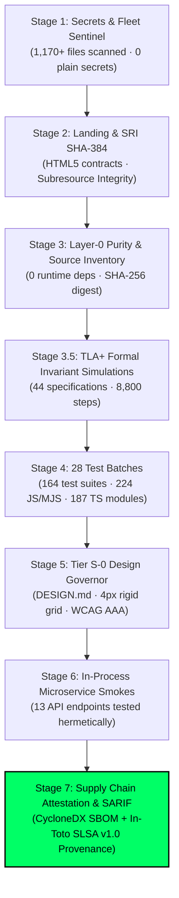

# Glorian System (formerly EOS System)

[](docs/evidence/fleet-audit.sarif)
[-gold?style=for-the-badge)](package.json)
[](docs/evidence/provenance.intoto.jsonl)
[](docs/tla/)
[-1DB954?style=for-the-badge&logo=spotify&logoColor=white)](docs/projects/registry.json)
[](DESIGN.md)
[](LICENSE)

> **Verified Engineering OS for Autonomous AI Swarms & Big-Tech SDLC Control Plane.**  
> Built for zero-vibe-coding, fail-closed governance, and hermetic multi-repository orchestration matching **Spotify** (Soundcheck / Golden Path / FleetShift) and **Nubank** (Datomic Bitemporal Ledger / Functional Purity) engineering standards.

---

## 🏛️ Executive Overview

**Glorian System** is a sovereign autonomous platform engineering control plane, specification-driven development (SDD) runtime, and cryptographic governance engine — verified **within tested scope** (not Level 5 / not absolute perfection). It translates natural-language engineering intent into formal IEEE 830 / ISO 29148 EARS specifications, Gherkin BDD scenarios, and dependency-ordered DAG tasks—executing multi-repository workflows with mathematical verification and zero unverified claims.

### The Six Inviolable Pillars

1. **Layer-0 Runtime Purity (Zero Production Dependencies)**:  
   The entire production control plane, CLI (`bin/eos.mjs`), core engines (`src/core/`), and MCP server run on native Node.js APIs without a single external npm runtime dependency. Zero dependency supply chain risk.

2. **Spotify Soundcheck & Golden Path Fleet Mesh**:  
   Orchestrates and audits a registered fleet of **10 distinct repositories** in real-time, verifying porcelain git cleanliness, test coverage, SARIF emissions, and canary rollout thresholds (Canary Health Index - CHI) with deterministic automated rollback.

3. **Nubank-Inspired Bitemporal Ledger & Immutability**:  
   Maintains a cryptographically sealed, append-only SQLite WAL ledger (`data/eos_bitemporal.wal`) tracking transaction time alongside valid domain time, ensuring full auditability and zero accidental state mutability.

4. **TLA+ Formal Invariant Modeling**:  
   Includes 44 formal specifications modeled and simulated with 8,800+ deterministic steps, proving safety, liveness, and zero-deadlock properties across ring buffers (LMAX Disruptor), consensus meshes, and state transitions before code execution.

5. **Closed-Loop AST Surgical Self-Healing (Meta SapFix Standard)**:  
   Performs automatic fault localization, causal blast radius extraction (< 5ms), candidate patch synthesis at the AST level, and hermetic sandboxed validation—discarding failing patches fail-closed.

6. **Model Context Protocol (MCP) Enterprise Architecture**:  
   Exposes both stdio and authenticated HTTP/SSE endpoints with Tier-0 core profiles (curated ≤ 30 tools) and Tier-S full profiles for seamless integration into Google Antigravity, Claude Desktop, and autonomous coding agents.

---

## 🌐 Registered Fleet Governance (10 Active Repositories)

Glorian governs and synchronizes a multi-repository ecosystem via `docs/projects/registry.json`:

| Repository / Project ID | Archetype / Purpose | Tier | Soundcheck Quorum | Production URL |
|---|---|:---:|:---:|---|
| `eos-system` | Sovereign Control Plane & Platform Kernel | Tier-0 | 100/100 | [eos-system-ten.vercel.app](https://eos-system-ten.vercel.app) |
| `aberamentho` | Music DSP, Solar Archetypes & Audio Engine | Tier-1 | 100/100 | [aberamentosprelomamusic.vercel.app](https://aberamentosprelomamusic.vercel.app) |
| `atp-strength` | High-Performance Biomechanics Engine | Tier-1 | 100/100 | [atp-strength.vercel.app](https://atp-strength.vercel.app) |
| `biblioteca-gnostica-1`| Semantic Knowledge Graph & Text Search | Tier-1 | 100/100 | [biblioteca-gnostica.vercel.app](https://biblioteca-gnostica.vercel.app) |
| `control-de-asistencia-abopack` | Industrial Logistics & Attendance Engine | Tier-1 | 100/100 | [avo-pack.vercel.app](https://avo-pack.vercel.app) |
| `crud-slack` | Real-Time Collaboration & Webhook Adapter | Tier-1 | 100/100 | [crud-slack.vercel.app](https://crud-slack.vercel.app) |
| `donaciones` | Transnational Fintech & Checkout Adapter | Tier-1 | 100/100 | [donaciones-drab.vercel.app](https://donaciones-drab.vercel.app) |
| `kegel-ham-sah` | Pelvic Health & Habit Tracking PWA | Tier-1 | 100/100 | [kegel-ham-sah-trasnmutacion-y-forta.vercel.app](https://kegel-ham-sah-trasnmutacion-y-forta.vercel.app) |
| `performance-talent-group` | Talent Intelligence & Enterprise ATS | Tier-1 | 100/100 | [ptg-performance-talent-group.vercel.app](https://ptg-performance-talent-group.vercel.app) |
| `portafolio` | Public Portfolio & Interactive Studio | Tier-1 | 100/100 | [portafolio-valentin.vercel.app](https://portafolio-valentin.vercel.app) |

---

## 🚦 The 7-Stage Sovereign CI/CD Gate (`npm run verify:strict`)

Before any release or commit is accepted, Glorian enforces a fail-closed verification pipeline with 0 false positives:



---

## ⚡ Quickstart

### Prerequisites

* Node.js 22.0.0 or higher
* Git 2.40 or higher
* Docker Engine (optional, required only for offline container sandboxes)

### Installation

```bash
# Clone the sovereign repository
git clone https://github.com/valentinflorezarbelaez-ai/Glorian-System-.git
cd Glorian-System-

# Install locked development tools (TypeScript compiler & Node type defs only)
npm ci

# Verify the complete sovereign gate (7 stages, 164 test suites)
npm run verify:strict

# Check supply chain cryptographic congruence
npm run supply-chain:verify
```

---

## 🛠️ CLI Operations Guide (`bin/eos.mjs`)

| Command | Category | Functionality |
|---|---|---|
| `node bin/eos.mjs help` | Help | Display CLI command matrix and flags. |
| `node bin/eos.mjs guard [dir]` | Security | Analyze source tree for architecture breaches and circular dependencies. |
| `node bin/eos.mjs amplify "prompt"` | SDD | Amplify natural language into formal EARS requirements and BDD scenarios. |
| `node bin/eos.mjs graph` / `blast <file>` | AST Graph | Calculate causal blast radius and dependency DAG for a target file. |
| `node bin/eos.mjs heal <file> --dry-run` | FDIR | Run closed-loop AST surgical healing (SapFix candidate patch). |
| `node bin/eos.mjs flow inspect "<path>"` | Flow | Non-mutating structural health inspection of a target Git repository. |
| `node bin/eos.mjs flow plan "<path>" "task"` | Flow | Formalize change specification and atomic task plan. |
| `node bin/eos.mjs flow start "<path>" "task"`| Worktree | Initialize an isolated Git worktree under `.worktrees/flow-<uuid>`. |
| `node bin/eos.mjs sandbox doctor` | Sandbox | Audit local Docker seccomp, cgroups v2, and pinned rootless container. |
| `node bin/eos.mjs turbo` | Performance | Execute turbo pipeline audit across all system subsystems in < 150ms. |

---

## 🔌 Model Context Protocol (MCP) Integration

Glorian exposes an enterprise-grade MCP server compatible with Google Antigravity, Claude Desktop, and autonomous agents:

### 1. Stdio Mode (Native Agent Integration)
```bash
npm run mcp
```

### 2. HTTP/SSE Mode with Bearer Authentication
```bash
npm run mcp:stream
```
* Generates an ephemeral 256-bit bearer token.
* Restricts requests strictly to allowed origins (`EOS_MCP_ALLOWED_ORIGINS`).
* Curated Tier-0 core profile (≤ 30 tools) for optimal agent context window efficiency.

---

## 🎨 Tier S-0 Design System & Interactive Cockpit

* **Geometric Precision**: Strict 4px/8px rigid spatial grid enforced by automated static AST linters (`scripts/eos-design-system-govern.mjs`).
* **Visual Contrast**: Full WCAG 2.1 AA / AAA compliance with Solar Archetype tokens (`--solar-gold`, `--void-pitch`).
* **Interactive Cockpits**:
  - `index.html`: Sovereign landing guide, live fleet radar, and architectural contracts catalog.
  - `src/ui/eosStudioConsole.html`: Real-time operational cockpit, AST self-healing simulator, and bitemporal ledger explorer.

---

## 📜 Epistemic Integrity & Truth in Advertising

In strict accordance with the **EOS Constitution (Law III: The Law of Evidence Over Claims)**:
* Local checks verify source syntax, type safety, test assertions, SRI hashes, TLA+ bounded simulations, and mock handler contracts.
* Stage 7/7 local success indicates zero broken invariants within the tested local perimeter.
* Live cloud deployments, vendor probes, and multi-tenant telemetry are evaluated strictly via explicit remote probes with verifiable receipts.

---

## 📄 License

Distributed under the **MIT License**. See `LICENSE` for details.

**Author & Sovereign Architect**: [Valentín Flórez Arbeláez](https://github.com/valentinflorezarbelaez-ai)
