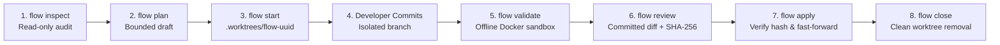

<div align="center">


# Glorian System

### Sovereign Layer-0 Software Engineering Control Plane (formerly EOS System)

[](https://github.com/valentinflorezarbelaez-ai/Glorian-System-/actions/workflows/eos-gate.yml)
[](https://github.com/valentinflorezarbelaez-ai/Glorian-System-/actions/workflows/eos-codeql.yml)
[](https://nodejs.org/en/blog/release/v22.18.0)
[](tsconfig.typecheck.json)
[](package.json)
[](scripts/coverage-gate.mjs)
[](.githooks/commit-msg)
[](LICENSE)

[**Quickstart**](#quickstart) · [**Architecture & Workflow**](#architecture--approval-gated-workflow) · [**CLI Reference**](#cli--npm-command-reference) · [**MCP Security**](#local-mcp-httpsse-security) · [**Agent Boundaries**](#agent-tool-boundaries) · [**API Routes**](#api-routes) · [**Developer Guide**](docs/DEVELOPER_GUIDE.md)

</div>

---

## Overview

**Glorian System** is a sovereign software engineering control plane uniting a browser governance console, zero-dependency Node.js CLI utilities, Layer-0 static and structural analysis modules, formal TLA+ specifications, and Vercel serverless routes for deterministic engineering workflows.

> **Epistemic Transparency & Scope Notice:** Some pages and endpoints are interactive demonstrations. Static fixtures, generated drafts, local benchmarks, and project registry entries are not evidence of production health, external vendor integrations, formal verification, or live deployment. The site does not connect AI agents or probe production systems by default.

<div align="center">
  
</div>

### Core Pillars

- **Pure Layer-0 Control Plane:** Built exclusively on native Node.js 22.18+ primitives with built-in TypeScript type stripping and **zero third-party runtime dependencies** (enforced by Law V in CI).
- **Approval-Gated Engineering Lifecycle (`eos flow`):** Deterministic progression from read-only repository inspection and planning to isolated Git worktrees, network-disabled Docker validation, SHA-256 diff attestation, and conflict-checked local branch fast-forwarding.
- **Hardened Local MCP Transport:** Supports stdio (`npm run mcp`) and authenticated local HTTP/SSE (`npm run mcp:stream`) with 256-bit bearer tokens, strict origin allowlists, 1 MiB payload ceilings, and a read-only HTTP tool catalog.
- **Defense-in-Depth Container Sandboxing:** Executes untrusted validation tasks inside a network-disabled Linux Docker Engine pinned by immutable SHA-256 image digest, seccomp filtering, cgroup v2 limits, and a monitored 512 MiB workspace copy.

---

## Quickstart

```sh
# 1. Prerequisites: Node.js >= 22.18 (built-in TypeScript type stripping)
node --version

# 2. Clone and install pinned dev toolchain
git clone [https://github.com/valentinflorezarbelaez-ai/Glorian-System-.git](https://github.com/valentinflorezarbelaez-ai/Glorian-System-.git)
cd Glorian-System-
npm ci

# 3. Verify the toolchain (typecheck + full test suite, ~3 min)
npm run check

# 4. Explore the CLI
npx eos help             # show all available commands
npx eos flow inspect .   # analyze current repository (read-only)

# 5. Run the full 7-stage SecDevOps gate
npm run test:ci
```

### System Requirements

- **Node.js 22.18+** with built-in TypeScript type stripping.
- **Zero third-party runtime dependencies** (`dependencies: {}`, enforced in CI).
- **Git 2.30+** for sovereign repository hooks (`git config core.hooksPath .githooks`).
- **Pinned Dev Toolchain:** Run `npm ci` to install the locked compiler and type definitions (`TypeScript 7`, `@types/node 24`).

---

## Architecture & Approval-Gated Workflow

`flow` joins the local repository audit, Honk task draft, Git worktrees, and the network-disabled Docker sandbox into one deterministic lifecycle. Inspection and planning never write to the target repository. The audit score counts bounded local structural signals; it does not assess production readiness, execute tests, verify CI results, or replace security scanners.



### Step-by-Step Workflow Commands

```sh
# 1. Inspect and plan (read-only)
node bin/eos.mjs flow inspect "<repo-path>"
node bin/eos.mjs flow plan "<repo-path>" "<change to make>"

# 2. Initialize isolated worktree and workflow state
node bin/eos.mjs flow start "<repo-path>" "<change to make>"

# 3. Edit only in the printed worktree, then commit your changes on that branch

# 4. Validate inside the network-disabled Docker sandbox
node bin/eos.mjs flow validate "<repo-path>" <workflow-id> -- npm test

# 5. Review the committed diff and copy its SHA-256 digest
node bin/eos.mjs flow review "<repo-path>" <workflow-id>

# 6. Apply via explicit cryptographic confirmation
node bin/eos.mjs flow apply "<repo-path>" <workflow-id> --confirm-diff=<sha256-from-review>

# 7. Inspect status and close clean worktree
node bin/eos.mjs flow status "<repo-path>" <workflow-id>
node bin/eos.mjs flow close "<repo-path>" <workflow-id>
```

### Lifecycle Guarantees

- **`start`:** Requires a clean, named base branch and creates `.worktrees/flow-<uuid>` plus ignored state under `.eos/workflows/`. If needed, it appends those two directory patterns to the repository's local `.git/info/exclude` without editing tracked project files.
- **`validate`:** Requires a committed branch and runs the supplied executable in the network-disabled Docker sandbox. The command and dependencies must already be present in the locally available immutable image.
- **`review`:** Requires successful validation of the exact branch `HEAD`, a clean worktree, and an unchanged base branch; prints the committed diff and its `SHA-256` hash.
- **`apply`:** Accepts only the exact `SHA-256` review hash, rechecks the diff and base branch, and fast-forwards the base branch locally.
- **`close`:** Removes the worktree only if clean by default, preserves the branch, and requires `--force` to discard uncommitted files. None of these commands pushes or deploys. An external project pilot is still needed to measure acceptance, false positives, failures, time, and reversibility.

---

## CLI & NPM Command Reference

Commands that write files, change Git configuration, commit, or push should be reviewed before use. In particular, fleet ship mode can stage, commit, and push to `origin` for one explicitly selected project.

| Command                                       | Category       | Behavior                                                                                                                                                |
| :-------------------------------------------- | :------------- | :------------------------------------------------------------------------------------------------------------------------------------------------------ |
| `node bin/eos.mjs help`                       | CLI Core       | Show the CLI help and command catalog.                                                                                                                  |
| `node bin/eos.mjs guard [directory]`          | Analysis       | Inspect local source dependencies and report architecture findings.                                                                                     |
| `node bin/eos.mjs amplify "prompt"`           | Scaffolding    | Generate a local EARS/BDD prompt scaffold. Review before use.                                                                                           |
| `node bin/eos.mjs eval <file>`                | Heuristics     | Run local cognitive-evaluation heuristics on a file (not an external LLM eval).                                                                         |
| `node bin/eos.mjs graph` / `blast <file>`     | Provenance     | Build a local source graph and report transitive dependencies.                                                                                          |
| `node bin/eos.mjs heal <file> --dry-run`      | Remediation    | Request a local dry-run healer report (`src/core/eosAutonomousHealer.ts`).                                                                              |
| `node bin/eos.mjs worktree list`              | Isolation      | List active Git worktrees for this repository.                                                                                                          |
| `node bin/eos.mjs sandbox doctor`             | Sandbox        | Check local Linux Docker Engine, registered runtimes (`runc` / gVisor `runsc`, `gvisorAvailable`), seccomp, cgroup v2, and pinned image digest.         |
| `node bin/eos.mjs sandbox run <dir> -- <cmd>` | Sandbox        | Run a command offline in a filtered temporary worktree copy (`--runtime runc\|runsc\|auto`); add `--apply` for conflict-checked writeback on exit 0.    |
| `node bin/eos.mjs honk "<task>"`              | Planning       | Produce a bounded local task draft without editing code, branching, or opening PRs.                                                                     |
| `node bin/eos.mjs flow <action> ...`          | Governance     | Execute the `inspect → plan → start → validate → review → apply → close` lifecycle.                                                                     |
| `npm run mcp`                                 | MCP Server     | Start the local MCP stdio server (1 MiB request ceiling).                                                                                               |
| `npm run mcp:stream`                          | MCP Server     | Start authenticated local MCP HTTP/SSE on `127.0.0.1:3333` with a read-only tool allowlist.                                                             |
| `npm run typecheck`                           | Verification   | Strictly type-check `src/**/*.ts` with the locked TypeScript compiler.                                                                                  |
| `npm run test:workflow`                       | Verification   | Test the core approval-gated workflow and CLI entry point across Windows, macOS, and Linux.                                                             |
| `npm run verify:fast`                         | Pre-Commit     | Run credential-pattern scan, TypeScript check, and suites impacted by the working tree.                                                                 |
| `npm run verify:strict`                       | SecDevOps Gate | Run credential scan, static checks, bounded simulations, TypeScript check, Node suites, and mocked handler smoke checks; emits local receipt and SARIF. |
| `npm run test:unit`                           | Verification   | Run the Node unit test file configured in `package.json`.                                                                                               |

---

## Local MCP HTTP/SSE Security

The `mcp:stream` server generates a fresh 256-bit bearer token at startup and prints it exclusively to the local terminal's `stderr` for client configuration.

- **Token Configuration:** Set `EOS_MCP_HTTP_TOKEN` to override the startup token (custom values must contain at least 32 bytes). Every HTTP route requires `Authorization: Bearer <token>`, including `/health` and metrics.
- **Read-Only HTTP Tool Allowlist:** Exposes only `eos_health_check`, `eos_amplify_prompt`, `eos_check_architecture`, `eos_evaluate_decision`, `eos_spotify_shuffle`, and `eos_optimize_context`. Mutating MCP tools and repository-file reads are never exposed over HTTP.
- **Origin & Resource Bounds:** Browser clients must explicitly configure `EOS_MCP_ALLOWED_ORIGINS` (e.g., `http://localhost:3000`; default is no browser origins). Requests without an `Origin` header remain available to native clients presenting the bearer token. Request bodies are bounded to **1 MiB**, body reads to **10 seconds**, and concurrent SSE sessions to **16**.

```sh
curl -H "Authorization: Bearer $EOS_MCP_HTTP_TOKEN" [http://127.0.0.1:3333/health](http://127.0.0.1:3333/health)
```

> **Security Warning:** The bearer token is a local capability. Never copy it into source control, screenshots, shared logs, or untrusted clients.

---

## Cryptography & Runtime Boundaries

### Cryptography Status (`EosVerifiableSecretSharingCore`)

`EosVerifiableSecretSharingCore` is **experimental and is not approved for production secrets**. It uses the 3072-bit RFC 3526 MODP Group 15 parameters, but the `BigInt` Verifiable Secret Sharing (VSS) implementation has not undergone an independent cryptographic audit and JavaScript `BigInt` does not guarantee constant-time arithmetic. Use a vetted, independently reviewed implementation for production key custody. The CLI VSS commands are demonstrations and refuse secrets passed as command-line arguments.

### Agent-Tool Boundaries

- **Local Planning Only (`Honk` & `Xirp`):** Provide local planning and context generation without running an external model or autonomous code-editing loop. Repository context is treated as untrusted data.
- **Manual Read-Only GitHub Action:** The Honk GitHub Actions workflow is manually invoked, read-only, and restricted to `main`. It does not consume issue comments, commit, push, or open pull requests, and redacts directive text and repository metadata from logs.
- **Worktree vs. Container & gVisor (`runsc`) Isolation:** Git worktrees isolate branches and working files, not processes, network access, or credentials. `eos sandbox run` enforces defense in depth using a local Linux Docker Engine (`EOS_SANDBOX_IMAGE` pinned by `repository@sha256:...`, built-in seccomp profile, cgroup v2 resource controllers, `--network none`, read-only rootfs, dropped capabilities, `no-new-privileges`, non-root UID, and a monitored 512 MiB workspace copy that excludes `.git`, the Docker socket, ignored files, and common secret paths). Runtime selection via `--runtime=runc|runsc|auto` (or `--runtime <value>`) supports Google gVisor (`runsc`): `sandbox doctor` probes `gvisorAvailable` and registered Docker runtimes, `auto` selects `runsc` when installed (otherwise `runc`), and explicit `--runtime=runsc` fails closed when `runsc` is missing from the local Docker daemon. With default `runc`, container isolation still depends on the host Linux kernel rather than a user-space kernel/microVM boundary.
- **Conflict-Checked Sandbox Writeback:** Sandbox output is discarded by default. Adding `--apply` writes back only after exit code `0`, rejects symlink output, and verifies that each target file still matches the copied baseline.
- **Strict MCP Mutation Types:** Mutating MCP options in stdio mode require strict JSON booleans set to `true` (strings such as `"true"` are rejected). File reads are confined to the configured repository root after symlink resolution.

### Standalone SEA Binaries & GitHub Releases

Every push to `main` builds a Single Executable Application (`SEA`) bundle (`dist/glorian-linux-x64`, detached Ed25519 signature `glorian-linux-x64.sig`, `dist/eos.blob`, CycloneDX SBOMs, in-toto provenance, and `dist/SHA256SUMS.txt`), attests it via `actions/attest-build-provenance`, and publishes the signed bundle to the corresponding GitHub Release (`v<version>`):

```sh
# Build standalone SEA release assets + dist/SHA256SUMS.txt locally
node scripts/build-sea-binary.mjs --bundle-release

# Verify downloaded checksums and native GitHub SLSA Build Provenance
sha256sum -c SHA256SUMS.txt
gh attestation verify glorian-linux-x64 --repo valentinflorezarbelaez-ai/Glorian-System-
```

---

## Sandbox Image Setup (PowerShell)

The example below pins the official `node:22-bookworm-slim` image to its multi-platform SHA-256 digest on Docker Hub. Verify the digest against the [official Docker Hub tag page](https://hub.docker.com/_/node/tags?name=22-bookworm&page=&page_size=) when refreshing. The sandbox runner never pulls images automatically.

```powershell
docker pull node:22-bookworm-slim@sha256:de170b39439eb0e5a3444ad7d60b015614a381e10fecae2e30ec9e735122f38d
$env:EOS_SANDBOX_IMAGE = "node:22-bookworm-slim@sha256:de170b39439eb0e5a3444ad7d60b015614a381e10fecae2e30ec9e735122f38d"
node bin/eos.mjs sandbox doctor
node bin/eos.mjs worktree add task
node bin/eos.mjs sandbox run .worktrees/task -- node --version
```

Include `--apply` before `--` to preserve successful edits from the temporary workspace copy. Because the container runs without network access, all compilers and dependencies must already reside inside the pinned image or copied workspace.

---

## Browser Demonstrations & Serverless API Routes

The root `index.html` serves as the browser guide and demo catalog; it cannot execute commands on your machine. Routes under `api/` follow Vercel serverless-function conventions.

### Browser Demo Scope

- **Command Console:** Previews commands in browser memory without executing a shell; only commands with an implemented CLI handler can be copied.
- **Development Form:** Generates text drafts in browser memory; does not write files, compile, test, scan, or deploy.
- **Memory Page:** Stores user notes in browser `localStorage`, filters locally, and exports Markdown; initial records are static examples with no server persistence, FTS5, Engram backend, or conflict tribunal.
- **Kernel, Big Tech, Omega & CI/CD Pages:** Present static concept fixtures, JavaScript loop timings, SHA-256 text fingerprinting, and CI/CD simulations. They do not run a Linux kernel, eBPF verifier, TLA+ model checker, PQC/ZK proofs, BFT consensus, or live repository checks.

### API Routes Matrix

All API responses must be interpreted according to their returned `status`, `note`, and execution flags. A `200 OK` HTTP response alone does not imply a subsystem or deployment was verified.

| Route                                         | Category      | Operational Scope                                                                                                                    |
| :-------------------------------------------- | :------------ | :----------------------------------------------------------------------------------------------------------------------------------- |
| `/api/health`                                 | Telemetry     | Handler liveness and process metadata; subsystems are marked not probed.                                                             |
| `/api/mcp`                                    | Protocol      | Stateless JSON-RPC over `POST` with a bounded read-only tool allowlist; no file reads, mutations, sessions, or SSE.                  |
| `/api/fleet`                                  | Registry      | Static project registry; performs no health, CI, hook, or deployment probes.                                                         |
| `/api/cicd`                                   | Simulation    | Bounded CI/CD simulation; executes no repository checks, SBOM generation, or deployment.                                             |
| `/api/bigtech`                                | Simulation    | Static scenario fixtures; runs no TLA+ model checking or fault injection.                                                            |
| `/api/kernel` & `/api/omega`                  | Fixtures      | Read-only Linux concept fixtures, SHA-256 text fingerprinting, and concept metadata; no kernel telemetry or cryptographic consensus. |
| `/api/memory`                                 | Fixtures      | Static sample records and action previews; no server persistence or FTS5.                                                            |
| `/api/eval`                                   | Heuristics    | Local evaluator with project-root confinement and a 100 KiB source limit.                                                            |
| `/api/titans`                                 | Benchmark     | Runs local benchmark code through the evaluator route; does not describe external vendor services.                                   |
| `/api/graph`                                  | Analysis      | Builds a local source graph when the engine loads; returns an explicit unavailable error otherwise.                                  |
| `/api/amplify` & `/api/compile`               | Transform     | Local prompt-scaffolding (`api/compile.js`), JS loop benchmark, and text transformation; no remote LLM calls.                        |
| `/api/jarvis`, `/api/spotify`, `/api/teurgia` | Deterministic | Deterministic application responses with no external AI, Spotify, or production control-plane connection.                            |

---

## Fleet Management & Deployment

### Fleet Environment Variables

The project registry references environment-variable names rather than workstation-specific file paths. Define a variable locally only when instructing a fleet command to inspect that checkout:

| Project                  | Environment Variable         |
| :----------------------- | :--------------------------- |
| **EOS / Glorian System** | `EOS_FLEET_EOS_SYSTEM_PATH`  |
| **Aberamentho**          | `EOS_FLEET_ABERAMENTHO_PATH` |
| **Portafolio**           | `EOS_FLEET_PORTAFOLIO_PATH`  |
| **PTG**                  | `EOS_FLEET_PTG_PATH`         |

- **Fleet Audit & Hooks:** Checks configured local Git roots and probes configured HTTPS URLs. Hook installation modifies Git hooks and `core.hooksPath` for one explicitly confirmed project ID (`pre-commit` and `pre-push` run the project's `cicdGateScript`).
- **Fleet Ship Mode:** Requires one project ID plus `--confirm-project=<id>`, a valid HTTPS production URL, an in-repository gate script (`.js`, `.mjs`, or `.ps1`), a valid local Git root, and an `origin` matching the registry. Runs the gate before staging all changes, committing, and pushing, followed by an HTTP 200 liveness check. Review the working tree before invoking ship mode.

### Deployment

`vercel.json` targets the project root and runs `node scripts/verify-cicd-pipeline.mjs` as the build command. Build verification, deployment, and live production health are separate operations.

---

## Documentation & Further Reading

- [**Glorian Developer Guide**](docs/DEVELOPER_GUIDE.md) — Recipes and architecture manuals covering the enterprise facade, peer mesh, memory arena, DTN, neuro-symbolic verifier, and IDE integration (Cursor / Antigravity).
- [**EOS Usability Pilot**](docs/USABILITY-PILOT.md) — First-time-user evaluation protocol, task script, and qualitative launch gate (no user-study results claimed yet).

## License

Released under the [MIT License](LICENSE).
