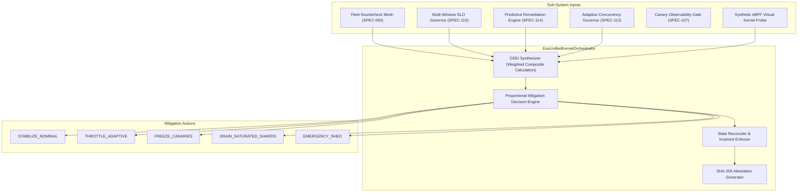

# PLAN-115: Unified Autonomous Operating System Kernel & Omni-Control Orchestrator

## 1. Architecture Overview

The `EosUnifiedKernelOrchestrator` integrates multiple Tier-0 resilience and telemetry sub-systems into an autonomous Sense $\to$ Analyze $\to$ Predict $\to$ Mitigate $\to$ Reconcile $\to$ Attest loop.



## 2. ADR-115: Unified Control Loop Design

- **Decision**: Implement a centralized Layer 0 state synthesizer and reconciler in pure TypeScript/Node.js standard library with zero external runtime npm dependencies (`dependencies: {}`).
- **Rejected Alternative 1: Microservices Multi-Process RPC Gossip**:
  - _Reason for Rejection_: Excessive IPC latency, failure modes from network partition during critical cascading outages, and violation of the Layer 0 zero-dependency hermetic principle.
- **Rejected Alternative 2: Polling Background Daemon without Deterministic Control Cycle**:
  - _Reason for Rejection_: Unbounded execution cycles and race conditions with in-flight test runners and CI/CD pipelines.

## 3. Data Contracts

```typescript
export interface KernelSystemTelemetry {
  fleetSoundcheckScore: number; // 0-100
  sloErrorBudgetConsumptionPct: number; // 0-100
  predictiveHazardSeverityPct: number; // 0-100
  concurrencyHeadroomPct: number; // 0-100
  syntheticSocketBacklog?: number; // 0-1000
  virtualPagePressurePct?: number; // 0-100
}

export type KernelMitigationAction =
  | "STABILIZE_NOMINAL"
  | "THROTTLE_ADAPTIVE"
  | "FREEZE_CANARIES"
  | "DRAIN_SATURATED_SHARDS"
  | "EMERGENCY_SHED";

export interface KernelReconciliationReceipt {
  cycleId: string;
  timestamp: number;
  oseiScore: number;
  state: "BALANCED" | "DEGRADED" | "CRITICAL";
  mitigationAction: KernelMitigationAction;
  canaryFreezeActive: boolean;
  sha256Attestation: string;
}
```
