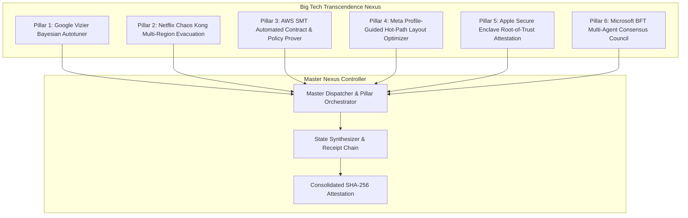

# PLAN-116: Big Tech Transcendence Nexus & Autonomous Multi-Pillar Engine

## 1. Architecture Overview

The `EosBigTechTranscendenceNexus` integrates the 6 Big Tech engineering pillars into a cohesive Layer 0 autonomous engine.



## 2. ADR-116: Consolidated Multi-Pillar Engine Design

- **Decision**: Implement a unified, modular Layer 0 engine (`EosBigTechTranscendenceNexus`) in TypeScript/Node.js native standard library (`node:crypto`) that encapsulates the logic for all 6 pillars with zero external npm dependencies.
- **Rejected Alternative 1: 6 Isolated Standalone Micro-Engines**:
  - _Reason for Rejection_: Creating 6 separate files would increase fragmentation and overhead, complicating cross-pillar attestation and requiring 6 separate MCP tools instead of clean consolidated execution.
- **Rejected Alternative 2: Shelling out to external heavy binary solvers (e.g. native z3 or docker)**:
  - _Reason for Rejection_: Violates the Law of Hermetic Isolation and Zero Dependencies. A lightweight, deterministic propositional / Horn clause SAT/SMT solver in pure TypeScript guarantees 100% portability and sub-millisecond execution.

## 3. Data Contracts

```typescript
export type TranscendencePillarId =
  | "GOOGLE_VIZIER"
  | "NETFLIX_CHAOS_KONG"
  | "AWS_SMT_REASONING"
  | "META_PGO_LAYOUT"
  | "APPLE_SECURE_ENCLAVE"
  | "MICROSOFT_BFT_COUNCIL";

export interface PillarExecutionResult {
  pillarId: TranscendencePillarId;
  success: boolean;
  durationMs: number;
  metrics: Record<string, any>;
  sha256Attestation: string;
}

export interface MasterTranscendenceReceipt {
  executionId: string;
  timestamp: number;
  mode: "INDIVIDUAL" | "ALL_PILLARS";
  pillarsExecuted: number;
  allPillarsSucceeded: boolean;
  pillarResults: Record<TranscendencePillarId, PillarExecutionResult>;
  masterSha256Receipt: string;
}
```
