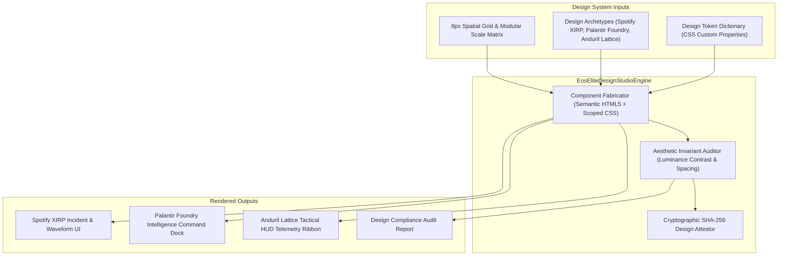

# PLAN-117: Elite Autonomous Design Engineering System & Multi-Archetype Studio

## 1. Architecture Overview

The `EosEliteDesignStudioEngine` acts as an autonomous design compiler and aesthetic invariant auditor.



## 2. ADR-117: Autonomous Elite Design Engine Design

- **Decision**: Implement a native, zero-dependency design generator and auditor (`EosEliteDesignStudioEngine`) in TypeScript/Node.js standard library (`node:crypto`) that compiles design tokens and accessible web components directly without external heavyweight CSS frameworks (e.g. Tailwind runtime or Bootstrap).
- **Rejected Alternative 1: External Node.js Sass/PostCSS compiler pipeline**:
  - _Reason for Rejection_: Introduces tens of transitive npm dependencies and breaks the Layer 0 zero-dependency rule (`dependencies: {}`). Modern CSS3 Custom Properties and CSS Grid/Flexbox provide superior layout performance with zero runtime overhead.
- **Rejected Alternative 2: Static templates without programmatic verification**:
  - _Reason for Rejection_: Static HTML snippets can drift, fail WCAG contrast rules on dark mode shifts, or violate the 8px grid. An active programmatic auditor guarantees aesthetic perfection on every render.

## 3. Data Contracts

```typescript
export type DesignArchetype = "SPOTIFY_XIRP" | "PALANTIR_FOUNDRY" | "ANDURIL_LATTICE";

export type DesignComponentType =
  | "INCIDENT_TIMELINE"
  | "WAVEFORM_MONITOR"
  | "TELEMETRY_GRID"
  | "TACTICAL_HUD"
  | "MISSION_CONTROL_DECK";

export interface DesignGenerationResult {
  archetype: DesignArchetype;
  componentType: DesignComponentType;
  htmlMarkup: string;
  scopedCss: string;
  tokens: Record<string, string>;
  wcagContrastRatio: number;
  sha256Attestation: string;
}

export interface DesignAuditResult {
  conformant: boolean;
  contrastRatio: number;
  wcagLevel: "AAA" | "AA" | "FAIL";
  spatialGridCompliant: boolean;
  semanticAriaValid: boolean;
  findings: string[];
  sha256Attestation: string;
}
```
