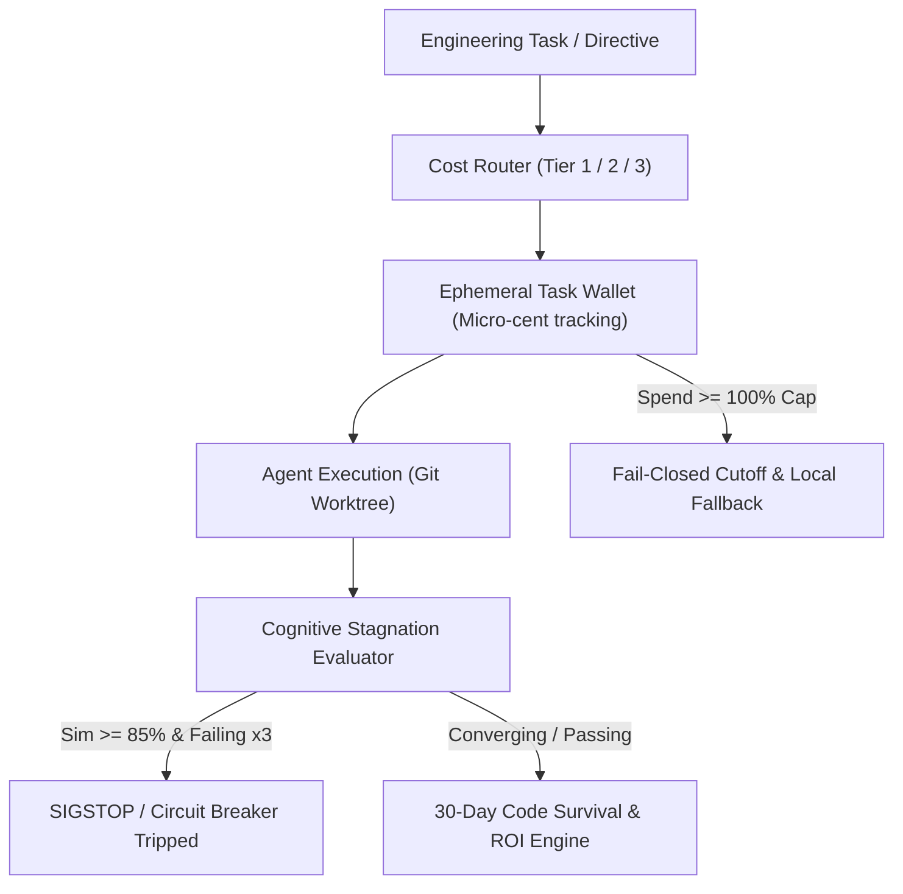

# PLAN-118: Architecture Plan & ADR-118 (Autonomous Agentic FinOps Governor)

## 1. Context & Architecture Decision Record (ADR-118)

### Title

ADR-118: Autonomous Agentic FinOps Governor, Dynamic Model Cost Routing, and Stagnation Circuit Breaker

### Status

ACCEPTED

### Context

Autonomous coding agents operating in multi-agent environments (e.g. Spotify Xirp, Nubank Meta) generate millions of inference tokens. Stochastic retries when encountering failing tests can lead to infinite loops consuming hundreds to thousands of dollars without making progress. A Layer 0 governor is required to enforce dynamic cost routing, cognitive stagnation circuit breaking, ephemeral task wallet caps, and code survival ROI tracking.

### Decision

Implement `EosAgenticFinOpsGovernor` in `src/core/eosAgenticFinOpsGovernor.ts` as a pure Layer 0 TypeScript module (`dependencies: {}`) using `node:crypto`.

1. **Dynamic Cost Routing**: Three discrete tiers:
   - `TIER_1_LOCAL_SLM`: Routine code inspection, AST outlining, formatting (Est. $0.05 - $0.15 / M tokens).
   - `TIER_2_BALANCED`: Standard component scaffolding, test authoring, business use cases (Est. $0.50 - $2.00 / M tokens).
   - `TIER_3_FRONTIER_REASONING`: Formal TLA+ proofs, bitemporal ledger transactions, complex concurrency resolution (Est. $5.00 - $15.00 / M tokens).
2. **Cognitive Stagnation Detection**: Normalized token Jaccard / Levenshtein similarity across consecutive diffs. If similarity >= 0.85 across 3 cycles with failing tests, trips `CIRCUIT_TRIPPED_STAGNATION` with `SIGSTOP_EMERGENCY`.
3. **Ephemeral Task Wallets**: Tracks `spendUsd` with `hardCapUsd`. Warns at 80%, locks fail-closed at 100% with local offline fallback.
4. **30-Day Code Survival Metric**: Tracks retained lines vs initial lines. Churn > 30% flags `NET_NEGATIVE_AI_DEBT`. Computes net financial savings vs. human developer hourly rate.

### Rejected Alternatives

- _External Cloud Billing Polling (AWS Cost Explorer / GCP Billing API)_: Rejected due to 24-48 hour latency; fail-closed token breakers require sub-second enforcement.
- _Blind Token Limits without Semantic Diffs_: Rejected because complex legitimate tasks require many tokens while stalled tasks burn tokens without changing code.
- _Third-party npm FinOps Libraries_: Rejected to maintain strict Layer 0 purity.

---

## 2. Component Diagram

