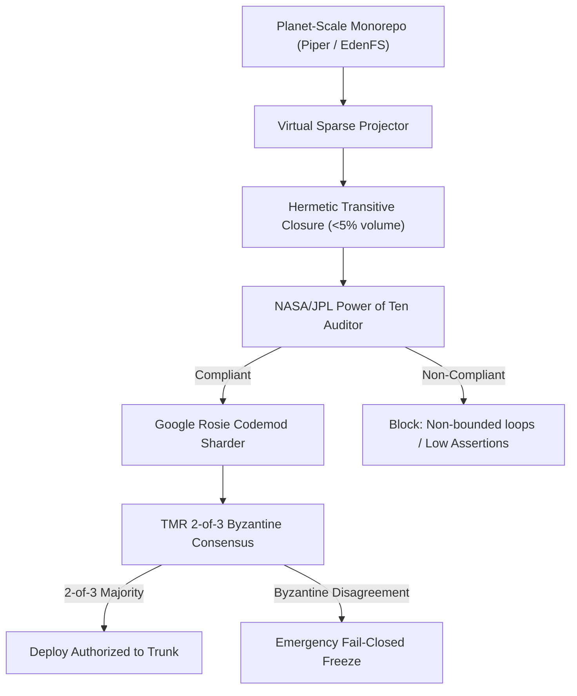

# PLAN-119: Architecture Plan & ADR-119 (Planetary Monorepo Engine & Aerospace Mission-Critical Governor)

## 1. Context & Architecture Decision Record (ADR-119)

### Title
ADR-119: Planetary Monorepo Sparse Graph Projection, NASA/JPL Power of Ten Safety Governance, and TMR Consensus

### Status
ACCEPTED

### Context
Handling planet-scale codebases (Google Piper, Meta EdenFS) and safety-critical mission systems (NASA/JPL Mars Rovers, Artemis flight control, planetary financial cores) requires:
1. Sublinear memory consumption through virtual sparse projection: resolving transitive dependencies without loading multi-gigabyte repositories into host memory.
2. Aerospace-grade static code verification enforcing Gerard Holzmann's NASA/JPL "Power of Ten" rules (bounded loops, assertion density >= 2/func, zero runtime dynamic allocations, restricted recursion).
3. Mass-refactoring orchestration (Google Rosie pattern) decomposing widespread API changes into topographically sorted, independently verifiable atomic codemod shards.
4. Byzantine fault mitigation via Triple Modular Redundancy (TMR) requiring 2-out-of-3 voting for Tier 0 infrastructure mutations.

### Decision
Implement `EosPlanetaryMonorepoGovernor` in `src/core/eosPlanetaryMonorepoGovernor.ts` as a 100% pure Layer 0 TypeScript module (`dependencies: {}`) using native `node:crypto`.
1. **Virtual Sparse Monorepo Projector**: Builds in-memory adjacency maps representing dependency trees, traverses transitive closures via DFS with cycle detection, and computes Merkle SHA-256 tree digests.
2. **NASA/JPL Power of Ten Static Auditor**: Parses AST code tokens and regex patterns to verify:
   - Rule 1: Control Flow Simplicity (no non-tail recursion, simple dispatch).
   - Rule 2: Fixed Upper Bounds on all loops (`for` loops must have constant/bounded condition).
   - Rule 3: Zero Dynamic Heap Allocation after init (flags `new Array(dynamic)`, unrestricted heap buffers).
   - Rule 4: Compact Function Size (length <= 60 lines).
   - Rule 5: Assertion Density (minimum 2 assert checks per function).
   - Rule 6: Minimal Scope (no global mutable variable exports).
   - Rule 7: Strict Return Checking (non-void functions must check or handle return states).
3. **Google Rosie Codemod Sharder**: Groups target packages into topological layers based on dependency depths, ensuring lower-level contracts update before higher-level consumers.
4. **Triple Modular Redundancy (TMR) Arbiter**: Computes cryptographic hashes of outputs from 3 independent reasoners, adjudicates 2-of-3 quorum, and fails closed (`TMR_BYZANTINE_SPLIT_REJECTED`) if unanimous or 2-of-3 agreement is absent.

### Rejected Alternatives
- *Full-Tree Repository Ingestion*: Rejected due to exponential memory exhaustion on monorepos > 50 GB.
- *Single-Agent High-Risk Mutator*: Rejected because stochastic LLM hallucinations in Tier 0 infrastructure can cause catastrophic production outages.
- *External Linter Dependencies*: Rejected to maintain strict Layer 0 independence.

---

## 2. Component Diagram

