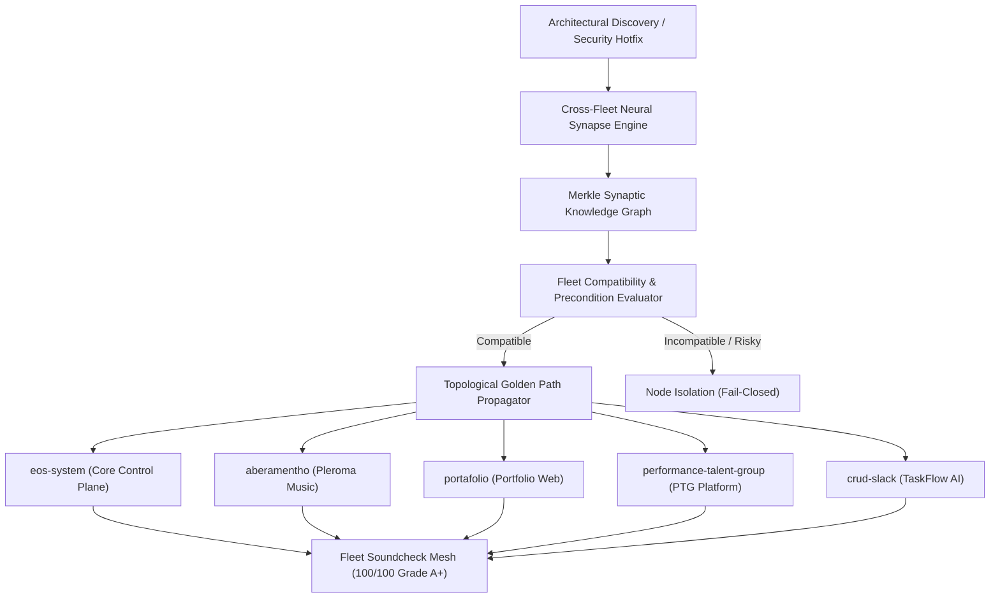

# PLAN-120: Architecture Plan & ADR-120 (Autonomous Cross-Fleet Neural Synapse)

## 1. Context & Architecture Decision Record (ADR-120)

### Title
ADR-120: Autonomous Cross-Fleet Neural Synapse & Dynamic Knowledge Synthesis

### Status
ACCEPTED

### Context
EOS System governs 5 registered production repositories (`eos-system`, `aberamentho`, `portafolio`, `performance-talent-group`, `crud-slack`). Currently, architectural discoveries (e.g. FinOps governors, zero-allocation buffers, bitemporal ledger transactions, JPL safety checkers) are developed in the control plane but lack an autonomous cross-fleet neural synapse to index, map, and propagate these patterns as verified Golden Paths across all satelite repositories without human intervention.

### Decision
Implement `EosCrossFleetNeuralSynapse` in `src/core/eosCrossFleetNeuralSynapse.ts` as a pure Layer 0 TypeScript module (`dependencies: {}`) using `node:crypto`.
1. **Dynamic Synaptic Knowledge Graph**:
   - Indexes discoveries into a formal knowledge graph with categories (`PERFORMANCE_OPT`, `SECURITY_HARDENING`, `FINOPS_GOVERNANCE`, `AEROSPACE_SAFETY`, `GOLDEN_PATH`).
   - Maintains content-addressed Merkle DAG of fleet patterns with SHA-256 root digests.
2. **Topological Golden Path Propagator**:
   - Maps patterns against each fleet repository in `registry.json`.
   - Generates migration plans (Spotify Fleetshift model) ordered topologically.
   - Evaluates compatibility matrix: if a repository lacks prerequisites, flags `ISOLATED_INCOMPATIBLE` fail-closed to protect working trees.
3. **Cross-Fleet Soundcheck Health Harmonizer**:
   - Evaluates real-time health across all 5 repositories.
   - Enforces 100/100 Grade A+ fleet invariant and verifies clean working trees before allowing autonomous deployment.

### Rejected Alternatives
- *Manual PR Scaffolding per Repository*: Rejected because manual coordination across 5 repositories introduces cognitive overhead and inevitable version drift.
- *Blind Shared-Code NPM Package*: Rejected because external package publishing creates network coupling, latency, and violates strict Layer 0 hermetic isolation.

---

## 2. Component Diagram

