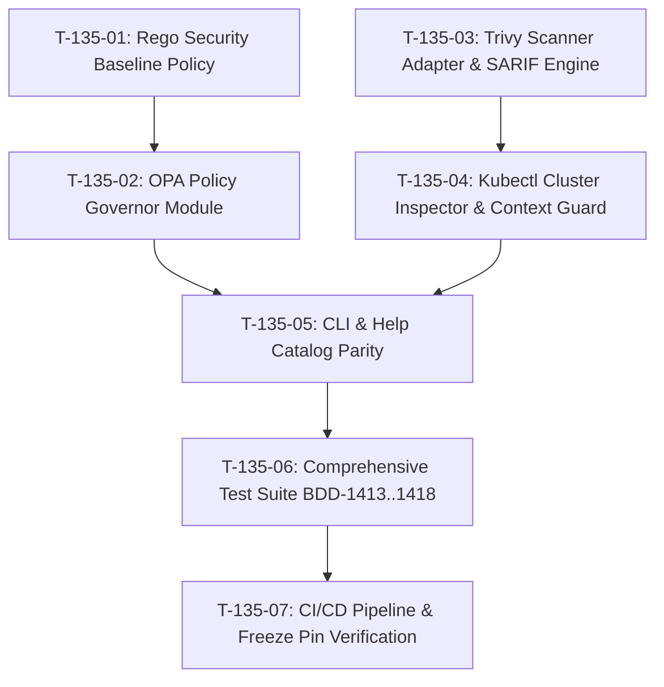

# TASKS-135: Atomic Execution DAG for Phase B Toolchain Adapters

## Atomic Tasks

- [x] **T-135-01**: Create `policies/k8s/security_baseline.rego` defining rules for non-privileged, runAsNonRoot, CPU/mem limits, and `:latest` tag prohibition.
- [x] **T-135-02**: Implement `src/core/eosOpaPolicyGovernor.ts` with manifest parsing, OPA evaluation, and violation detection.
- [x] **T-135-03**: Implement `src/core/eosTrivyScannerAdapter.ts` with safe `trivy fs` execution, SARIF transformation, threshold gating, and receipt hashing.
- [x] **T-135-04**: Implement `src/core/eosKubectlClusterInspector.ts` with `kind-*` context guard and read-only node/pod telemetry.
- [x] **T-135-05**: Register modules in `src/core/index.ts`, wire CLI subcommands `toolchain:scan`, `toolchain:policy`, `toolchain:k8s` in `bin/commands/cliDevOps.mjs`, and update `bin/commands/cliHelpCatalog.mjs` and `docs/DEVELOPER_GUIDE.md`.
- [x] **T-135-06**: Author test suite `test/eosToolchainAdaptersAndPolicyGovernor.test.mjs` covering BDD-1413 through BDD-1418 with fixtures.
- [x] **T-135-07**: Execute full 7-stage CI/CD pipeline verification, refresh tip, and seal freeze pin.
