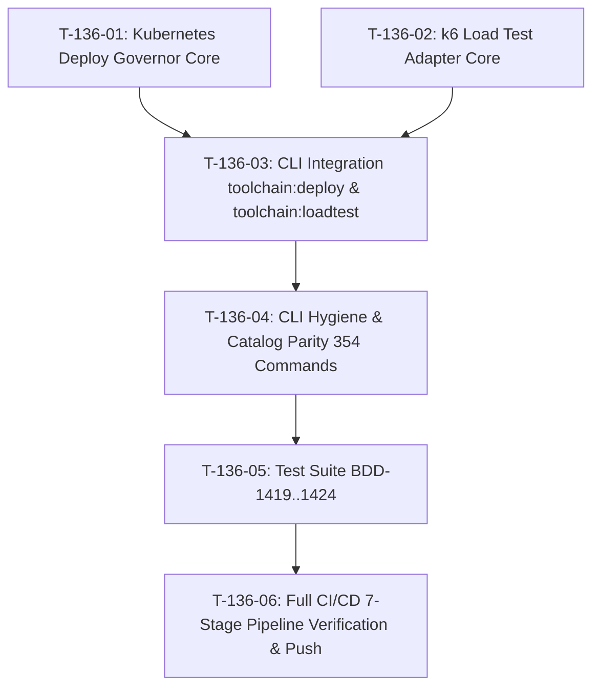

# TASKS-136: Atomic Execution DAG for Phase C Deployment & Load Testing

## Atomic Tasks

- [x] **T-136-01**: Implement `src/core/eosKubernetesDeployGovernor.ts` orchestrating Context Guard -> OPA Rego -> Server Dry-Run -> Explicit Apply with cryptographic receipts.
- [x] **T-136-02**: Implement `src/core/eosK6LoadTestAdapter.ts` with ephemeral script synthesis, k6 execution, SLO metrics extraction, and receipt generation.
- [x] **T-136-03**: Wire subcommands `toolchain:deploy` and `toolchain:loadtest` in `bin/commands/cliDevOps.mjs` and export in `src/core/index.ts`.
- [x] **T-136-04**: Update `bin/commands/cliHelpCatalog.mjs` and `docs/DEVELOPER_GUIDE.md` for CLI hygiene parity (352 -> 354 commands).
- [x] **T-136-05**: Author test suite `test/eosKubernetesDeployAndK6LoadTest.test.mjs` covering BDD-1419 through BDD-1424.
- [x] **T-136-06**: Execute full 7-stage CI/CD pipeline verification, refresh tip, seal freeze pin, and push to `origin/main`.
