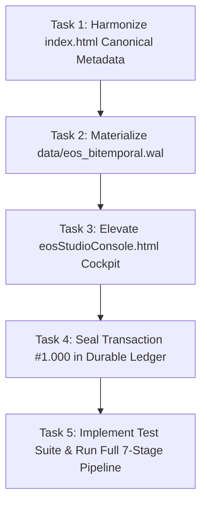

# TASKS-137: Atomic Task DAG — Glorian Millennium Sovereign Elevation

## Dependency Graph (DAG)

---

### Task 1: Harmonize `index.html` Canonical Metadata
- [ ] Replace `https://eos-system.vercel.app/` with `https://glorian-system.vercel.app/` in `canonical`, `og:url`, `og:image`, `twitter:image`, and Schema.org JSON-LD.
- [ ] Update OpenSpecs counters from `133` to `137`.

### Task 2: Materialize `data/eos_bitemporal.wal`
- [ ] Instantiate `EosDurableWal` at `data/eos_bitemporal.wal`.
- [ ] Write initial bitemporal transaction frames and flush to hardware disk with fsync.
- [ ] Verify `eos_wal_status` returns `exists: true`.

### Task 3: Elevate `src/ui/eosStudioConsole.html` Cockpit
- [ ] Update title and header to `GLORIAN SYSTEM // SOVEREIGN FLEET COCKPIT v75.0.0`.
- [ ] Update top telemetry indicators to 184 MCP tools, 137 Specs, 1.000 Ledger Entries.

### Task 4: Seal Transaction #1.000 in Durable Ledger
- [ ] Append transaction #999 (Fleet Health & Elevation Attestation).
- [ ] Append transaction #1.000 (`EOS-LEDGER-001000-GLORIAN-MILLENNIUM-SOVEREIGN-SEAL`).
- [ ] Verify cryptographic chain integrity.

### Task 5: Implement Test Suite & Run Full 7-Stage Pipeline
- [ ] Create `test/glorianMillenniumElevation.test.mjs` verifying BDD-362 to BDD-365.
- [ ] Run `npm run verify:strict` to ensure 0 broken invariants across all 7 stages.
