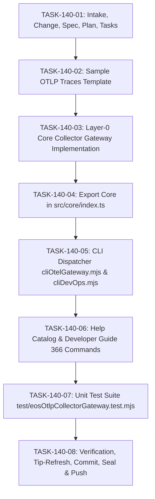

# TASKS-140: OpenTelemetry OTLP Collector Gateway Execution DAG

## Big Tech Distributed Observability Infrastructure (SPEC-278)

---

### Task Checklist

- [x] **TASK-140-01**: Record Intake, Change proposal, Formal Spec-278 (EARS FR-278-01..06, BDD-1443..1448), Architecture Plan, Tasks DAG.
- [ ] **TASK-140-02**: Author compliant sample OTLP trace batch in `templates/otel/sample-otlp-traces.json`.
- [ ] **TASK-140-03**: Implement pure Layer-0 `src/core/eosOtlpCollectorGateway.ts`.
- [ ] **TASK-140-04**: Export `EosOtlpCollectorGateway` from `src/core/index.ts`.
- [ ] **TASK-140-05**: Implement `bin/commands/cliOtelGateway.mjs` and wire delegation into `bin/commands/cliDevOps.mjs`.
- [ ] **TASK-140-06**: Update `bin/commands/cliHelpCatalog.mjs` and `docs/DEVELOPER_GUIDE.md` for 366 commands parity.
- [ ] **TASK-140-07**: Implement test suite `test/eosOtlpCollectorGateway.test.mjs` covering BDD-1443..1448.
- [ ] **TASK-140-08**: Run verification, hygiene audit, tip-refresh, commit, seal pin, and push.
