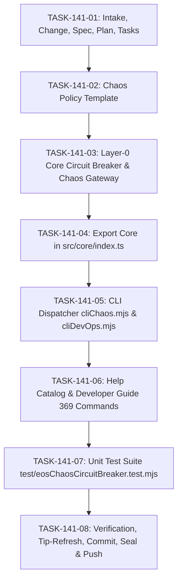

# TASKS-141: Chaos Engineering & Circuit Breaker Execution DAG

## Big Tech Fault Tolerance & Automated Resilience Infrastructure (SPEC-279)

---

### Task Checklist

- [x] **TASK-141-01**: Record Intake, Change proposal, Formal Spec-279 (EARS FR-279-01..06, BDD-1449..1454), Architecture Plan, Tasks DAG.
- [ ] **TASK-141-02**: Author compliant chaos resilience policy template in `templates/chaos/glorian-resilience-policy.json`.
- [ ] **TASK-141-03**: Implement pure Layer-0 `src/core/eosChaosCircuitBreaker.ts`.
- [ ] **TASK-141-04**: Export `EosChaosCircuitBreaker` and types from `src/core/index.ts`.
- [ ] **TASK-141-05**: Implement `bin/commands/cliChaos.mjs` and wire delegation into `bin/commands/cliDevOps.mjs`.
- [ ] **TASK-141-06**: Update `bin/commands/cliHelpCatalog.mjs` and `docs/DEVELOPER_GUIDE.md` for 369 commands parity.
- [ ] **TASK-141-07**: Implement test suite `test/eosChaosCircuitBreaker.test.mjs` covering BDD-1449..1454.
- [ ] **TASK-141-08**: Run verification, hygiene audit, tip-refresh, commit, seal pin, and push.
