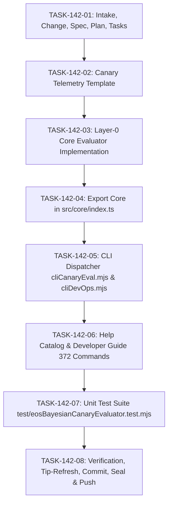

# TASKS-142: Bayesian Dynamic Canary Evaluation Execution DAG

## Big Tech Automated Canary Analysis & Rollback Gateway (SPEC-280)

---

### Task Checklist

- [x] **TASK-142-01**: Record Intake, Change proposal, Formal Spec-280 (EARS FR-280-01..06, BDD-1455..1460), Architecture Plan, Tasks DAG.
- [ ] **TASK-142-02**: Author compliant sample canary telemetry template in `templates/canary/sample-canary-telemetry.json`.
- [ ] **TASK-142-03**: Implement pure Layer-0 `src/core/eosBayesianCanaryEvaluator.ts`.
- [ ] **TASK-142-04**: Export `EosBayesianCanaryEvaluator` and types from `src/core/index.ts`.
- [ ] **TASK-142-05**: Implement `bin/commands/cliCanaryEval.mjs` and wire delegation into `bin/commands/cliDevOps.mjs`.
- [ ] **TASK-142-06**: Update `bin/commands/cliHelpCatalog.mjs` and `docs/DEVELOPER_GUIDE.md` for 372 commands parity.
- [ ] **TASK-142-07**: Implement test suite `test/eosBayesianCanaryEvaluator.test.mjs` covering BDD-1455..1460.
- [ ] **TASK-142-08**: Run verification, hygiene audit, tip-refresh, commit, seal pin, and push.
