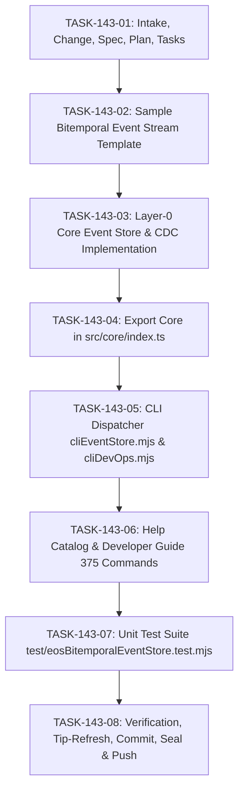

# TASKS-143: Bitemporal Event Store & CDC Execution DAG

## Big Tech Event Sourcing & CDC Architecture (SPEC-281)

---

### Task Checklist

- [x] **TASK-143-01**: Record Intake, Change proposal, Formal Spec-281 (EARS FR-281-01..06, BDD-1461..1466), Architecture Plan, Tasks DAG.
- [ ] **TASK-143-02**: Author compliant sample bitemporal event stream in `templates/events/sample-bitemporal-event-stream.json`.
- [ ] **TASK-143-03**: Implement pure Layer-0 `src/core/eosBitemporalEventStore.ts`.
- [ ] **TASK-143-04**: Export `EosBitemporalEventStore` and types from `src/core/index.ts`.
- [ ] **TASK-143-05**: Implement `bin/commands/cliEventStore.mjs` and wire delegation into `bin/commands/cliDevOps.mjs`.
- [ ] **TASK-143-06**: Update `bin/commands/cliHelpCatalog.mjs` and `docs/DEVELOPER_GUIDE.md` for 375 commands parity.
- [ ] **TASK-143-07**: Implement test suite `test/eosBitemporalEventStore.test.mjs` covering BDD-1461..1466.
- [ ] **TASK-143-08**: Run verification, hygiene audit, tip-refresh, commit, seal pin, and push.
