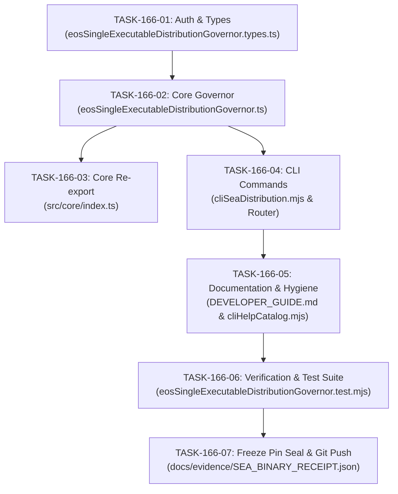

# TASKS-166: Single Executable Applications (SEA) Automated Binary Distribution

- **Task List ID**: `TASKS-166`
- **Spec Reference**: `SPEC-304`
- **Change Reference**: `CHANGE-166`
- **Plan Reference**: `PLAN-166`
- **Status**: `READY`

---

## 1. Task Dependency Graph (DAG)

---

## 2. Atomic Tasks Checklist

- [ ] **TASK-166-01**: Define contracts and interfaces in `src/core/eosSingleExecutableDistributionGovernor.types.ts`.
- [ ] **TASK-166-02**: Implement `EosSingleExecutableDistributionGovernor` in `src/core/eosSingleExecutableDistributionGovernor.ts` ($\le 800$ lines).
- [ ] **TASK-166-03**: Re-export modules in `src/core/index.ts` maintaining $\ge 12$ lines of headroom.
- [ ] **TASK-166-04**: Author CLI handlers in `bin/commands/cliSeaDistribution.mjs` and register in `bin/commands/cliToolchainRouter.mjs`.
- [ ] **TASK-166-05**: Register CLI commands in `bin/commands/cliHelpCatalog.mjs` and `docs/DEVELOPER_GUIDE.md` (total 455 commands). Verify with `node bin/eos.mjs hygiene:audit`.
- [ ] **TASK-166-06**: Author test suite `test/eosSingleExecutableDistributionGovernor.test.mjs` verifying BDD-1599..BDD-1604 (100% passing).
- [ ] **TASK-166-07**: Execute `toolchain:sea:audit`, write `docs/evidence/SEA_BINARY_RECEIPT.json`, refresh catalog, seal freeze pin, and push to `origin/main`.
