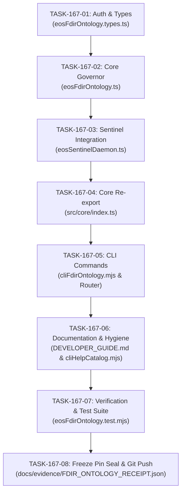

# TASKS-167: FDIR Clinical Firewall for Knowledge Ontology & Sentinel Integration

- **Task List ID**: `TASKS-167`
- **Spec Reference**: `SPEC-305`
- **Change Reference**: `CHANGE-167`
- **Plan Reference**: `PLAN-167`
- **Status**: `READY`

---

## 1. Task Dependency Graph (DAG)

---

## 2. Atomic Tasks Checklist

- [ ] **TASK-167-01**: Define contracts in `src/core/eosFdirOntology.types.ts`.
- [ ] **TASK-167-02**: Implement `EosFdirOntology` in `src/core/eosFdirOntology.ts` ($\le 800$ lines).
- [ ] **TASK-167-03**: Integrate live FDIR metrics into `EosSentinelDaemon.ts`.
- [ ] **TASK-167-04**: Re-export modules in `src/core/index.ts` maintaining $\ge 12$ lines of headroom.
- [ ] **TASK-167-05**: Author CLI handlers in `bin/commands/cliFdirOntology.mjs` and register in `bin/commands/cliToolchainRouter.mjs`.
- [ ] **TASK-167-06**: Register CLI commands in `bin/commands/cliHelpCatalog.mjs` and `docs/DEVELOPER_GUIDE.md` (total 459 commands). Verify with `node bin/eos.mjs hygiene:audit`.
- [ ] **TASK-167-07**: Author test suite `test/eosFdirOntology.test.mjs` verifying BDD-1605..BDD-1610 (100% passing).
- [ ] **TASK-167-08**: Execute `toolchain:fdir:audit`, write `docs/evidence/FDIR_ONTOLOGY_RECEIPT.json`, refresh catalog, seal freeze pin, and push to `origin/main`.
