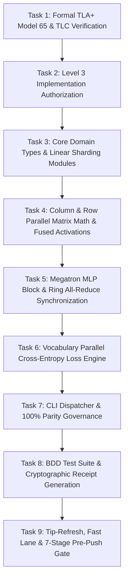

# TASKS-183: Megatron-LM Style Tensor Parallelism Implementation DAG

---

## Atomic Tasks Breakdown

1. **Task 1: Formal TLA+ Model 65 (`MegatronTensorParallelism.tla` & `.cfg`)**
   - Formal specification of column and row partitioning invariants, single-barrier synchronization, and numerical stability.
   - Register in `scripts/run-tlc.mjs` and verify with Leslie Lamport's TLC model checker.
2. **Task 2: Implementation Authorization**
   - Record Level 3 authorization in `IMPLEMENTATION_AUTHORIZATION.md`.
3. **Task 3 & 4: Core Domain Types & Implementation**
   - Create `src/core/eosMegatronTensorParallelism.types.ts` and `src/core/eosMegatronTensorParallelism.ts`.
   - Implement `partitionColumnParallel`, `partitionRowParallel`, `forwardColumnParallel`, `forwardRowParallel`, `fusedActivation` (GeLU & SiLU).
4. **Task 5: End-to-End Megatron MLP Block Execution**
   - Connect column-parallel output to fused activation, then to row-parallel projection, concluding with `RingAllReduce` from `src/core/eosRingAllReduce.ts`.
5. **Task 6: Sharded Vocabulary Cross-Entropy Engine**
   - Implement distributed Log-Sum-Exp cross-entropy across vocabulary shards.
6. **Task 7: CLI Dispatcher & Catalog Parity (528 $\to$ 533 commands)**
   - Create `bin/commands/cliMegatronTensorParallelism.mjs`.
   - Wire in `bin/commands/cliToolchainRouter.mjs`.
   - Register in `bin/commands/cliHelpCatalog.mjs` and `docs/DEVELOPER_GUIDE.md`.
   - Verify with `node bin/eos.mjs hygiene:audit --json` (`HYGIENE_GOVERNED`).
7. **Task 8: BDD Test Suite & Invariant Audit**
   - Create `test/eosMegatronTensorParallelism.test.mjs` (`BDD-1701`..`BDD-1706`).
   - Add coverage budget in `docs/quality/coverage-budget.json`.
   - Emit `docs/evidence/MEGATRON_TENSOR_PARALLELISM_RECEIPT.json`.
8. **Task 9: Tip-Refresh & Fast-Lane Verification**
   - Execute `node scripts/tip-refresh.mjs`.
   - Format with Prettier, run `node scripts/verify-fast.mjs`, commit, seal freeze pin, and push to `origin/main`.
