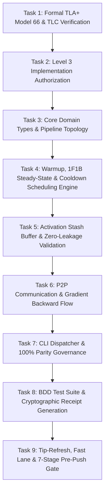

# TASKS-184: Pipeline Parallelism 1F1B Implementation DAG

---

## Atomic Tasks Breakdown

1. **Task 1: Formal TLA+ Model 66 (`PipelineParallelism1F1B.tla` & `.cfg`)**
   - Formally verify bounded activation memory invariant ($\le P$), completion of all $M$ micro-batches, and zero deadlocks.
   - Register in `scripts/run-tlc.mjs` and verify with Leslie Lamport's TLC model checker.
2. **Task 2: Implementation Authorization**
   - Record Level 3 authorization in `IMPLEMENTATION_AUTHORIZATION.md`.
3. **Task 3 & 4: Core Domain Types & Implementation**
   - Create `src/core/eosPipelineParallelism1F1B.types.ts` and `src/core/eosPipelineParallelism1F1B.ts`.
   - Implement pipeline stage topology, forward/backward computation, warmup steps, 1F1B interleaving, and cooldown drainage.
4. **Task 5 & 6: Activation Memory Bounds & P2P Queues**
   - Verify activation cache length $\le P$ at every discrete step; verify activation cache length $= 0$ at end.
5. **Task 7: CLI Dispatcher & Catalog Parity (533 $\to$ 538 commands)**
   - Create `bin/commands/cliPipelineParallelism1F1B.mjs`.
   - Wire in `bin/commands/cliToolchainRouter.mjs`.
   - Register in `bin/commands/cliHelpCatalog.mjs` and `docs/DEVELOPER_GUIDE.md`.
   - Verify with `node bin/eos.mjs hygiene:audit --json` (`HYGIENE_GOVERNED`).
6. **Task 8: BDD Test Suite & Invariant Audit**
   - Create `test/eosPipelineParallelism1F1B.test.mjs` (`BDD-1707`..`BDD-1712`).
   - Add coverage budget in `docs/quality/coverage-budget.json`.
   - Emit `docs/evidence/PIPELINE_PARALLELISM_1F1B_RECEIPT.json`.
7. **Task 9: Tip-Refresh & Fast-Lane Verification**
   - Execute `node scripts/tip-refresh.mjs`.
   - Format with Prettier, run `node scripts/verify-fast.mjs`, commit, seal freeze pin, and push to `origin/main`.
