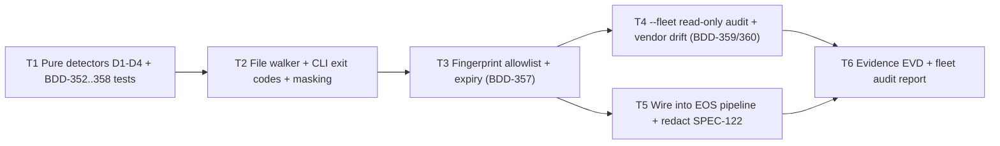

# SPEC-123: FLEET SECRET-SCAN GATE — REAL HARDCODED-CREDENTIAL DETECTION FOR EVERY EOS-GOVERNED REPOSITORY

## 1. Metadata

- **Specification ID**: `SPEC-123`
- **Project ID**: `eos-system` (canonical tool) + fleet repositories listed in `docs/projects/registry.json` (read-only audit)
- **Standard**: IEEE 830 / ISO 29148 · EOS Constitution Law III (Evidence over Claims) & Law VI (Zero Plain Secrets)
- **Status**: `PROPOSED` — awaiting owner approval (Law II gate)
- **Layer**: Layer-0 pure domain detectors + thin CLI adapter (`dependencies: {}`)
- **Date**: `2026-11-02`

---

## 2. Intake & Evidence (Why this spec exists)

| #   | Finding                                                                                                                                                                                                                                       | Evidence                                                                                            |
| --- | --------------------------------------------------------------------------------------------------------------------------------------------------------------------------------------------------------------------------------------------- | --------------------------------------------------------------------------------------------------- |
| 1   | Avo Pack `scripts/verify-strict.mjs` Stage 3 prints `Zero-Plain-Secrets Verified` but performs **no secret scan** (it only checks `vercel.json` headers and CSS selectors). The gate reported 7/7 PASS while a master password was hardcoded. | `Control-De-Asistencia-Abopack/scripts/verify-strict.mjs` L63-L70                                   |
| 2   | The master password remains hardcoded in publicly served ES modules after the UI-only fix of 2026-11-02.                                                                                                                                      | `src/domain/avopakDataset.mjs` L228-L271, `src/domain/avopakProcessAppsEngine.mjs` L176/591/598/640 |
| 3   | EOS's existing `SECRET_PATTERNS` only match vendor token formats (`sk-live`, `ghp_`, `AKIA`, `AIza`, PEM). A human-chosen password assigned to a variable is **not detectable** by the current EOS barrier.                                   | `src/core/eosPatchValidator.ts` L29-L35                                                             |
| 4   | EOS's own `SPEC-122` embeds the same password in plain text (BDD-340).                                                                                                                                                                        | `openspec/specs/SPEC-122-AVOPAK-ATTENDANCE-CONTROL.md`                                              |

Engram reference: observation #1149.

---

## 3. Formal Functional Requirements (EARS Syntax)

- **FR-366 [Ubiquitous / Permanent]**:
  `EL SISTEMA proveerá un escáner de secretos canónico, sin dependencias externas, ejecutable con Node.js >= 18 sobre cualquier repositorio local, que analice todos los archivos de texto versionados (git ls-files) o, en ausencia de git, todos los archivos de texto del árbol excluyendo node_modules, .git, dist y archivos binarios.`

- **FR-367 [Event-Driven] — Vendor tokens (D1)**:
  `CUANDO un archivo contenga un token con formato de proveedor conocido (OpenAI/Stripe sk-live/sk_live_/rk_live_, GitHub ghp_/gho_/github_pat_, AWS AKIA, Google AIza, Slack xox[abprs]-, bloque PEM de llave privada, o un JWT cuyo payload declare role = service_role), EL SISTEMA reportará un hallazgo de severidad BLOCK con archivo, línea y detector D1.`

- **FR-368 [Event-Driven] — Hardcoded credential assignment (D2)**:
  `CUANDO un identificador cuyo nombre coincida con password, passwd, pwd, pass, clave, contraseña, contrasena, secret, apiKey, api_key, token o masterPassword sea asignado (mediante =, : o como argumento por defecto) a un literal de texto de 6 o más caracteres, EL SISTEMA reportará un hallazgo BLOCK con detector D2, salvo que el valor sea un marcador no secreto (cadena vacía, solo asteriscos/puntos/x, o una referencia a process.env / import.meta.env).`

- **FR-369 [Event-Driven] — Prefilled password inputs (D3)**:
  `CUANDO un archivo HTML o una plantilla de texto contenga un elemento input con type="password" y un atributo value no vacío, EL SISTEMA reportará un hallazgo BLOCK con detector D3.`

- **FR-370 [Event-Driven] — Literal propagation (D4)**:
  `CUANDO un literal haya sido identificado como credencial por D1, D2 o D3, EL SISTEMA buscará ese mismo literal exacto en todos los archivos escaneados y reportará cada aparición adicional (textos de ayuda, placeholders, títulos, documentación, especificaciones, pruebas) como hallazgo BLOCK con detector D4.`

- **FR-371 [Ubiquitous / Permanent] — No secret echo**:
  `EL SISTEMA nunca imprimirá el valor completo de un secreto en consola, reportes JSON ni evidencia; mostrará únicamente los 2 primeros caracteres, la longitud y una huella sha256 truncada a 12 caracteres.`

- **FR-372 [Error / Unwanted Condition] — No vacuous PASS**:
  `SI el escáner analiza 0 archivos, o no puede leer la raíz indicada, ENTONCES EL SISTEMA terminará con código de salida 2 y el mensaje "SCAN_NOT_EXECUTED", sin imprimir PASS.`

- **FR-373 [Event-Driven] — Exit codes & report**:
  `CUANDO el escaneo finalice, EL SISTEMA terminará con código 0 si no hay hallazgos BLOCK activos, con código 1 si existe al menos uno, e imprimirá el número de archivos escaneados, el número de hallazgos por detector y, con la bandera --json, un reporte estructurado legible por máquina.`

- **FR-374 [State-Driven] — Fingerprint allowlist with expiry**:
  `MIENTRAS exista una entrada vigente en .eos/secret-allowlist.json que coincida en archivo y huella sha256 del literal, con motivo no vacío y fecha de expiración no mayor a 90 días desde su creación, EL SISTEMA degradará ese hallazgo a severidad ALLOWED; SI la entrada está vencida, carece de motivo o excede 90 días, ENTONCES EL SISTEMA ignorará la entrada y mantendrá el hallazgo como BLOCK.`

- **FR-375 [Event-Driven] — Fleet audit (read-only)**:
  `CUANDO se ejecute el escáner con la bandera --fleet, EL SISTEMA resolverá la ruta local de cada proyecto registrado en docs/projects/registry.json mediante su variable localPathEnv, escaneará cada repositorio en modo solo lectura, reportará los proyectos cuya ruta no esté configurada como SKIPPED_NO_PATH, y escribirá un reporte consolidado únicamente dentro de EOS (docs/audits/), sin modificar ningún archivo de los repositorios de la flota.`

- **FR-376 [Event-Driven] — Vendored copy drift**:
  `CUANDO el modo --fleet encuentre una copia del escáner en scripts/eos-secret-scan.mjs de un proyecto, EL SISTEMA comparará su huella sha256 con la versión canónica de EOS y reportará VENDOR_DRIFT si difieren o VENDOR_MISSING si el proyecto no la incluye.`

### Non-Functional Requirements

- **NFR-123-1**: Zero runtime dependencies; single ESM file; no network access.
- **NFR-123-2**: Scans a 500-file repository in under 2 seconds on a standard laptop.
- **NFR-123-3**: Deterministic output (files and findings sorted by path, then line).
- **NFR-123-4**: Detector logic is pure (input: text + path → findings) and 100% covered by unit tests.

---

## 4. Acceptance Criteria (BDD Gherkin Standard)

```gherkin
ESCENARIO: BDD-352 Detecta contraseña humana asignada en código (caso Avo Pack)
  DADO un módulo con la línea masterPassword: "Ejemplo2026*.@"
  CUANDO se ejecuta el escáner sobre el repositorio
  ENTONCES reporta 1 hallazgo BLOCK del detector D2 con archivo y línea
  Y el código de salida es 1
  Y la salida no contiene el texto "Ejemplo2026*.@"

ESCENARIO: BDD-353 Propagación del literal a textos de ayuda y especificaciones
  DADO el literal "Ejemplo2026*.@" detectado por D2 en src/domain/data.mjs
  Y el mismo literal dentro de un <code> en index.html y en un archivo .md
  CUANDO se ejecuta el escáner
  ENTONCES reporta 2 hallazgos adicionales del detector D4, uno por archivo

ESCENARIO: BDD-354 Campo de contraseña precargado en HTML
  DADO un index.html con <input type="password" id="login" value="Ejemplo2026*.@">
  CUANDO se ejecuta el escáner
  ENTONCES reporta un hallazgo BLOCK del detector D3

ESCENARIO: BDD-355 Marcadores no secretos no generan falsos positivos
  DADO un archivo con password: "", apiKey: process.env.API_KEY y value="" en un input password
  CUANDO se ejecuta el escáner
  ENTONCES reporta 0 hallazgos
  Y el código de salida es 0

ESCENARIO: BDD-356 No existe PASS vacío
  DADO una ruta raíz sin archivos de texto
  CUANDO se ejecuta el escáner
  ENTONCES termina con código 2 y el mensaje "SCAN_NOT_EXECUTED"
  Y no imprime la palabra PASS

ESCENARIO: BDD-357 Lista de excepciones con huella y expiración
  DADO un hallazgo D2 en test/auth.test.mjs
  Y una entrada en .eos/secret-allowlist.json con esa huella, motivo "fixture de prueba" y expiración vigente
  CUANDO se ejecuta el escáner
  ENTONCES el hallazgo se marca ALLOWED y el código de salida es 0
  Y SI la fecha de expiración ya pasó, ENTONCES el hallazgo vuelve a ser BLOCK y el código de salida es 1

ESCENARIO: BDD-358 Token de proveedor y JWT service_role
  DADO un archivo con un token con prefijo ghp_ de 36 caracteres y un JWT cuyo payload contiene "role":"service_role"
  CUANDO se ejecuta el escáner
  ENTONCES reporta 2 hallazgos BLOCK del detector D1
  Y un JWT con "role":"anon" no genera hallazgo

ESCENARIO: BDD-359 Auditoría de flota en solo lectura
  DADO 2 proyectos registrados, uno con localPathEnv configurado y otro sin configurar
  CUANDO se ejecuta el escáner con --fleet
  ENTONCES el primero se escanea y el segundo se reporta SKIPPED_NO_PATH
  Y la suma sha256 de todos los archivos del repositorio escaneado es idéntica antes y después
  Y el reporte consolidado se escribe solo en docs/audits/ de EOS

ESCENARIO: BDD-360 Detección de copia desactualizada del escáner
  DADO un proyecto con scripts/eos-secret-scan.mjs cuya huella difiere de la versión canónica
  CUANDO se ejecuta el escáner con --fleet
  ENTONCES el proyecto se reporta con estado VENDOR_DRIFT
```

---

## 5. Architecture Plan & ADRs

### Module layout (EOS)

```text
tools/fleet/eos-secret-scan.mjs      # Single-file canonical scanner (pure detectors + CLI adapter)
test/eos-secret-scan.test.mjs        # BDD-352..360 (node:test, synthetic fixtures only)
.eos/secret-allowlist.json           # Fingerprint-based exceptions (no secret values stored)
docs/audits/FLEET-SECRET-SCAN-<date>.json  # Read-only fleet audit output
```

Inside the single file, detectors (`detectVendorTokens`, `detectCredentialAssignments`, `detectPrefilledPasswordInputs`, `propagateLiterals`) are pure functions; file I/O and `process.exit` live only in the CLI section.

### ADR-123-1: Distribution model — vendored single file with hash drift check

- **Decision**: Canonical file lives in EOS. Each fleet repository will carry an identical copy at `scripts/eos-secret-scan.mjs`, invoked from its own `verify:strict`. EOS `--fleet` mode detects drift by sha256.
- **Rejected — npm package**: Adds a runtime/dev dependency and breaks the Layer-0 `dependencies: {}` rule used across the fleet; requires a publish pipeline.
- **Rejected — fleet repos call EOS by local path**: Fails in GitHub Actions and Vercel builds, where the EOS checkout does not exist.
- **Rejected (for now) — gitleaks / trufflehog binaries**: Mature and stronger at entropy detection, but require an external binary unavailable in Vercel builds. Recommended as a future optional complement, not a replacement.

### ADR-123-2: Fingerprint allowlist instead of path-based ignores

- **Decision**: Exceptions match on file + sha256 fingerprint of the literal, require a reason, and expire within 90 days.
- **Rejected — ignoring `test/` folders**: The Avo Pack test suite contains the production password; a folder exemption would have hidden the real leak.
- **Rejected — storing the literal in the allowlist**: Would itself be a plaintext secret.

### ADR-123-3: Rollout respects Law IV (External Write Barrier)

- **Phase 1** (this spec): Scanner + tests + integration into the EOS pipeline; remediate EOS's own findings (redact the password in SPEC-122).
- **Phase 2** (this spec): Read-only `--fleet` audit report across registered repositories.
- **Phase 3** (out of scope, separate authorization per repository): Vendor the scanner into each fleet repository's `verify:strict`. Avo Pack **will fail** this gate until its authentication is redesigned server-side or an explicit, expiring exception is approved by the owner.

### Out of scope

- Rotating the Avo Pack password and moving its authentication server-side (separate spec; owner decision).
- Rewriting git history to purge leaked values.
- Replacing `eosPatchValidator.ts` `SECRET_PATTERNS` (follow-up: align it with the canonical detector list once Phase 1 is verified).

---

## 6. Atomic Task DAG



| Task   | Done criteria (verifiable)                                                                                                                        |
| ------ | ------------------------------------------------------------------------------------------------------------------------------------------------- |
| **T1** | Tests for BDD-352..355 and BDD-358 written first and failing; then passing. Detectors are pure (no `fs`, no `process`).                           |
| **T2** | CLI scans a real directory; exit codes 0/1/2 proven by tests; no full secret appears in stdout (asserted). BDD-356 passes.                        |
| **T3** | BDD-357 passes for valid, expired, reason-less, and >90-day entries.                                                                              |
| **T4** | BDD-359 passes with a before/after sha256 tree checksum of the scanned repository; BDD-360 passes.                                                |
| **T5** | `scripts/verify-cicd-pipeline.mjs` invokes the scanner and fails on exit code 1; EOS scan of itself returns exit 0 after SPEC-122 redaction.      |
| **T6** | `docs/evidence/EVD-SPEC-123.json` with raw command output and exit codes; `docs/audits/FLEET-SECRET-SCAN-2026-11-02.json` generated by `--fleet`. |

---

## 7. Authorization

- **Current state**: `PROPOSED`. No implementation code may be written (Law II).
- **Required to proceed**: Owner approval of this specification, then a `LEVEL 2` entry in `IMPLEMENTATION_AUTHORIZATION.md` scoped to EOS-System Phases 1–2.
