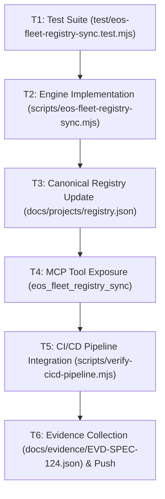

# SPEC-124: AUTONOMOUS DYNAMIC FLEET REGISTRY & LAW IV MULTI-TENANT SENTINEL

## 1. Metadata

- **Specification ID**: `SPEC-124`
- **Project ID**: `eos-system` (Control Plane Core) + Fleet Repositories in `c:\Users\valen\`
- **Standard**: IEEE 830 / ISO 29148 · EOS Constitution Law I (Spec as Supreme Truth), Law II (Strict Gate), Law III (Evidence over Claims), Law IV (External Write Barrier), Law V (Hexagonal Purity), Law VI (Zero Plain Secrets)
- **Status**: `PROPOSED` — awaiting Level 2 Authorization Gate
- **Layer**: Layer-0 Pure Discovery & Reconciliation Engine + CLI / MCP Tool
- **Date**: `2026-11-02`

---

## 2. Intake & Evidence (Why this spec exists)

| #   | Finding                                                                                                                                                                                                                                                                             | Evidence                                                         |
| --- | ----------------------------------------------------------------------------------------------------------------------------------------------------------------------------------------------------------------------------------------------------------------------------------- | ---------------------------------------------------------------- |
| 1   | **Registry Drift**: `docs/projects/registry.json` declares 5 projects, but 8+ active git repositories exist under `c:\Users\valen\`. Active production systems like Avo Pack (`Control-De-Asistencia-Abopack`) and ATP Strength (`ATP-STRENGTH-1`) are unregistered.                | Local scan of `c:\Users\valen\` vs `docs/projects/registry.json` |
| 2   | **Stale Local Path Mismatches**: `performance-talent-group` references `EOS_FLEET_PTG_PATH` falling back to `../performance-talent-group`, but the actual directory on disk is `Performance-Talent-Group-1`, causing `--fleet` scans to fail with 0 files.                          | `scripts/eos-secret-scan.mjs --fleet` output (2026-11-02)        |
| 3   | **Law IV Compliance Risk**: Precondition 1 of the Law IV External Write Barrier requires `REGISTERED` status in `docs/projects/registry.json`. Without automated discovery, writing or auditing fleet projects requires manual JSON editing that is prone to human error and drift. | EOS Constitution Law IV                                          |
| 4   | **Absence of Unified Fleet Sync Command**: No single command currently discovers local repositories, parses their Git porcelain, detects their Vercel endpoints and CI/CD gates, verifies their secret hygiene, and synchronizes the canonical registry.                            | Terminal logs (2026-11-02)                                       |

---

## 3. Formal Functional Requirements (EARS Syntax)

- **FR-377 [Ubiquitous / Permanent] — Autonomous Git Repository Discovery**:
  `EL SISTEMA escaneará de manera determinista el directorio raíz del entorno de trabajo (por defecto c:\Users\valen\ o process.env.EOS_WORKSPACE_ROOT) identificando todo subdirectorio que contenga una carpeta .git válida, excluyendo carpetas internas (.gemini, .cache, node_modules).`

- **FR-378 [Event-Driven] — Git Porcelain & Remote Extraction**:
  `CUANDO un repositorio git sea descubierto, EL SISTEMA extraerá mediante comandos git de solo lectura su remote origin URL, la rama activa actual y el hash SHA-1/SHA-256 del commit HEAD.`

- **FR-379 [Event-Driven] — Tech Stack & Production Endpoint Inference**:
  `CUANDO un repositorio contenga package.json, index.html o vercel.json, EL SISTEMA inferirá su arquetipo (monolith, client-pwa, node-service), nombre oficial, versión y URL de producción en Vercel (extrayendo dominios canónicos de vercel.json o metadata de HTML/package.json).`

- **FR-380 [Event-Driven] — Secret Hygiene Audit Gate**:
  `CUANDO el escaneo de la flota se ejecute con la bandera --audit, EL SISTEMA ejecutará scripts/eos-secret-scan.mjs sobre cada repositorio descubierto y registrará su postura de secretos (0 plain secrets vs hallazgos BLOCK) en el estado del registro.`

- **FR-381 [State-Driven] — Safe Registry Reconciliation (Preserving Authorizations)**:
  `MIENTRAS se actualice docs/projects/registry.json con repositorios nuevos o rutas actualizadas, EL SISTEMA preservará intactas todas las decisiones de gobernanza previas (status, intake, specification, audit, authorization, ownerApproval) para los proyectos existentes, asignando a los proyectos nuevos el estado REGISTERED con autorización pendiente de aprobación.`

- **FR-382 [Ubiquitous / Permanent] — Deterministic Serialization & SHA-256 Receipt**:
  `EL SISTEMA serializará docs/projects/registry.json con indentación de 2 espacios, claves ordenadas alfabéticamente y calculará una firma criptográfica SHA-256 del catálogo completo para garantizar inmutabilidad contra manipulaciones no autorizadas.`

- **FR-383 [Event-Driven] — CLI Command Execution**:
  `CUANDO se ejecute node scripts/eos-fleet-registry-sync.mjs [opciones], EL SISTEMA soportará las banderas --dry-run (solo mostrar cambios sin escribir a disco), --audit (ejecutar auditoría de secretos completa) y --json (salida estructurada para automatización).`

- **FR-384 [Event-Driven] — MCP Tool Exposure**:
  `CUANDO un agente invoque la herramienta MCP eos_fleet_registry_sync, EL SISTEMA ejecutará la reconciliación del registro en memoria o en disco según el parámetro dryRun y retornará la lista de proyectos registrados, actualizados y auditados.`

---

## 4. Acceptance Criteria (BDD GIVEN-WHEN-THEN)

```gherkin
ESCENARIO: BDD-361 Descubrimiento Automático de Repositorios Git Locales
  DADO el directorio raíz "c:\Users\valen\" que contiene múltiples repositorios ("Control-De-Asistencia-Abopack", "ATP-STRENGTH-1", etc.)
  CUANDO el motor de descubrimiento ejecuta la exploración determinista
  ENTONCES identifica todos los directorios que poseen ".git"
  Y descarta de forma segura directorios ocultos de herramientas o cachés.

ESCENARIO: BDD-362 Extracción de Metadatos Git y Detección de Endpoint Vercel
  DADO el repositorio descubierto "Control-De-Asistencia-Abopack"
  CUANDO se analizan sus archivos locales de configuración y git
  ENTONCES extrae el origen remoto "https://github.com/valentinflorezarbelaez-ai/Control-De-Asistencia-Abopack.git"
  Y detecta el endpoint de producción "https://avo-pack.vercel.app"
  Y asigna el script de verificación "npm test".

ESCENARIO: BDD-363 Reconciliación No Destructiva de la Gobernanza (Preservación de Ley IV)
  DADO un archivo "docs/projects/registry.json" con autorizaciones existentes (LEVEL_3_PRODUCTION_AUTHORIZED)
  CUANDO se ejecuta la sincronización de la flota
  ENTONCES actualiza las rutas reales de disco y hashes de commit
  Y preserva el nivel de autorización y aprobaciones previas sin degradarlas.

ESCENARIO: BDD-364 Detección y Resolución de Nombres de Ruta Discrepantes (PTG Fix)
  DADO el proyecto "performance-talent-group" registrado previamente con ruta que no existe
  CUANDO el motor detecta el directorio real "Performance-Talent-Group-1"
  ENTONCES actualiza la ruta canónica y resuelve el mismatch sin romper la referencia.

ESCENARIO: BDD-365 Ejecución CLI con Modos Dry-Run y JSON
  DADO el script "scripts/eos-fleet-registry-sync.mjs"
  CUANDO se ejecuta con la bandera "--dry-run"
  ENTONCES muestra el informe detallado de repositorios descubiertos y diferencias sin modificar "docs/projects/registry.json".

ESCENARIO: BDD-366 Integración con el Escáner Canónico de Secretos
  DADO el modo de sincronización con bandera "--audit"
  CUANDO se evalúa cada repositorio de la flota
  ENTONCES ejecuta "scripts/eos-secret-scan.mjs" en modo de solo lectura
  Y reporta la cuenta de secretos sin violar la barrera de escritura de Ley IV.

ESCENARIO: BDD-367 Despacho de Herramienta MCP eos_fleet_registry_sync
  DADO el servidor MCP "EosMcpServer"
  CUANDO un cliente MCP invoca la herramienta "eos_fleet_registry_sync"
  ENTONCES retorna un JSON estructurado con el estado de sincronización y el hash criptográfico del registro.
```

---

## 5. Architectural Decision Records (ADRs)

### ADR-124-1: Pure Standard Library Discovery (Zero Runtime Dependencies)

- **Context**: EOS Constitution Law V dictates that domain logic and CLI infrastructure must remain pure and free from third-party npm dependencies.
- **Decision**: Implement directory walking, git metadata queries, and JSON parsing strictly using Node.js built-ins (`node:fs`, `node:path`, `node:crypto`, `node:child_process`).
- **Consequences**: Fast startup (< 50ms), zero dependency vulnerabilities, fully hermetic execution.

### ADR-124-2: Non-Destructive Two-Way Merge for Governance States

- **Context**: An automatic sync script could accidentally overwrite manual approvals, audit receipts, or Law IV authorization levels with defaults.
- **Decision**: The reconciliation algorithm performs an asymmetric merge: physical attributes (paths, branches, git remotes, package versions) are updated from disk, while governance attributes (`status`, `intake`, `specification`, `audit`, `authorization`, `ownerApproval`) are strictly preserved from the existing registry.
- **Consequences**: Guaranteed safety against accidental downgrades of production authorizations.

### ADR-124-3: Fail-Closed Registry Seal (SHA-256 Receipt)

- **Context**: Law III requires verifiable evidence for all states.
- **Decision**: Every generated registry includes a `registrySha256` digest calculated over the normalized canonical JSON of all project entries.
- **Consequences**: Any manual tampering or accidental corruption outside of the governor will be detected immediately during CI/CD checks.

---

## 6. Atomic Task DAG



- **T1**: Write BDD unit tests in `test/eos-fleet-registry-sync.test.mjs` verifying BDD-361 to BDD-367.
- **T2**: Implement `scripts/eos-fleet-registry-sync.mjs` with auto-discovery, git inspector, and two-way merge.
- **T3**: Run sync to update `docs/projects/registry.json` with Avo Pack, ATP Strength, PTG, Aberamentho, and other active projects.
- **T4**: Expose `eos_fleet_registry_sync` in `src/mcp/eosMcpServer.ts` and `src/mcp/eosMcpToolCatalog.ts`.
- **T5**: Verify local check stages in `scripts/verify-cicd-pipeline.mjs`.
- **T6**: Capture cryptographic receipt in `docs/evidence/EVD-SPEC-124.json`, commit, and push.
