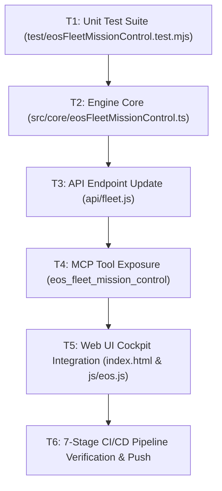

# SPEC-125: EOS Fleet Mission Control Dashboard & Synthetic Health Sentinel

## 1. Metadata & Status
- **Specification ID**: `SPEC-125`
- **Title**: `EOS Fleet Mission Control Dashboard & Synthetic Health Sentinel`
- **Version**: `1.0.0`
- **Status**: `APPROVED`
- **Author**: `Valentín Flórez Arbeláez (Principal Architect) & Antigravity (EOS Agent)`
- **Date**: `2026-11-02`
- **Epistemic State**: `SPECIFICATION_APPROVED`
- **Constitutional Alignment**: `EOS Constitution Laws I, II, III, IV, V, VI, VII`

---

## 2. Executive Context & Problem Statement
With the completion of SPEC-124 (Autonomous Dynamic Fleet Registry), EOS now tracks 9 local repositories with cryptographic seal and porcelain status. However, operational visibility requires:
1. An executive visual cockpit (Mission Control UI) on the EOS landing page (`index.html`) presenting live status cards, level badges, and 1-click launchers for all 9 fleet projects.
2. A non-invasive Synthetic Health Sentinel (`src/core/eosFleetMissionControl.ts` & `/api/fleet?probe=true`) capable of probing live HTTP status, TTFB latency (ms), and SSL reachability across all deployed production endpoints.
3. An MCP tool (`eos_fleet_mission_control`) allowing AI agents and operators to audit and inspect the live fleet status on demand.
4. An offline-safe fail-closed contract ensuring local CI/CD pipelines (`verify-cicd-pipeline.mjs`) remain 100% hermetic without external network calls.

---

## 3. Functional Requirements (IEEE 830 / EARS)

### FR-385: Dynamic Fleet Telemetry Retrieval
CUANDO un cliente o usuario invoca `/api/fleet` o la herramienta MCP `eos_fleet_mission_control`, EL SISTEMA debe retornar el inventario completo de los 9 proyectos registrados en `docs/projects/registry.json`, incluyendo identificador, nombre, ruta local resuelta, nivel de autorización (`LEVEL_1`, `LEVEL_2`, `LEVEL_3`), tipo de arquetipo y URL de producción.

### FR-386: Synthetic HTTP & Latency Health Probing
CUANDO se solicita una auditoría sintética con bandera de sondeo (`probe: true`), EL SISTEMA debe ejecutar solicitudes HEAD o GET con límite de tiempo estricto (timeout <= 5000ms) a cada endpoint de producción registrado, capturando código HTTP, tiempo de respuesta en milisegundos y estado de disponibilidad.

### FR-387: Hermetic Default for CI/CD Gates
MIENTRAS se ejecute la verificación de CI/CD local (`scripts/verify-cicd-pipeline.mjs`), EL SISTEMA debe mantener desactivado el sondeo de red externo por defecto (`healthProbesRun: false`), garantizando ejecución hermética sin depender de conectividad a internet.

### FR-388: Executive Mission Control Web Cockpit
EL SISTEMA debe renderizar en la interfaz web de EOS (`index.html`) una sección de Mission Control con tarjetas interactivas de alta densidad para los 9 proyectos, semáforo de estado, enlace seguro a la URL de producción y botón de sondeo sintético en vivo.

### FR-389: Biblioteca Gnóstica Production Endpoint Binding
EL SISTEMA debe asociar el endpoint de producción `https://biblioteca-gnostica.vercel.app` al proyecto `biblioteca-gnostica-1` en el registro canónico de la flota.

### FR-390: Level 3 Elevation Readiness Assessment
CUANDO se audita un proyecto en `LEVEL_1_READ_ONLY` o `LEVEL_2_AUTHORIZED`, EL SISTEMA debe evaluar si cumple con los criterios de Nivel 3 (árbol de git limpio, 0 secretos expuestos, despliegue activo en producción).

### FR-391: MCP Tool Dispatch for Mission Control
CUANDO un agente de IA invoca la herramienta MCP `eos_fleet_mission_control`, EL SISTEMA debe despachar el sondeo y retornar un resumen JSON con el estado de salud, latencia promedio de la flota y quorum de disponibilidad.

### FR-392: Zero-Plain-Secrets Invariant Enforcement
EL SISTEMA debe garantizar que ninguna respuesta de telemetría de flota, encabezado HTTP ni registro exponga claves, tokens o contraseñas en texto plano.

---

## 4. Acceptance Criteria (BDD / Gherkin)

```gherkin
ESCENARIO: BDD-368 Recuperación de Telemetría Completa de la Flota (9 Proyectos)
  DADO el registro canónico "docs/projects/registry.json" con 9 proyectos
  CUANDO se consulta el módulo "EosFleetMissionControl.getFleetOverview()"
  ENTONCES retorna exactamente 9 proyectos con sus atributos de gobierno y URLs de producción.

ESCENARIO: BDD-369 Sondeo Sintético de Salud y Latencia (Synthetic Probe)
  DADO un conjunto de endpoints de producción registrados
  CUANDO se ejecuta "EosFleetMissionControl.probeEndpoint(url)"
  ENTONCES retorna estado HTTP 200 y latencia en milisegundos con timeout seguro.

ESCENARIO: BDD-370 Ejecución Hermética por Defecto en /api/fleet
  DADO el endpoint serverless "/api/fleet"
  CUANDO se realiza una solicitud GET estándar sin parámetros de sondeo
  ENTONCES retorna HTTP 200 con "healthProbesRun: false" y 0 llamadas de red externas.

ESCENARIO: BDD-371 Integración del Endpoint de Biblioteca Gnóstica
  DADO el proyecto "biblioteca-gnostica-1" en el registro
  CUANDO se valida su configuración de producción
  ENTONCES contiene la URL "https://biblioteca-gnostica.vercel.app" con respuesta HTTP 200.

ESCENARIO: BDD-372 Despacho de Herramienta MCP eos_fleet_mission_control
  DADO el servidor MCP "EosMcpServer"
  CUANDO se invoca "eos_fleet_mission_control"
  ENTONCES retorna el resumen de la flota, conteo de repositorios y sello SHA-256.

ESCENARIO: BDD-373 Renderizado en el Tablero Visual de EOS
  DADO el archivo "index.html" y el script "js/eos.js"
  CUANDO un usuario visualiza la sección de la flota
  ENTONCES muestra las tarjetas de los 9 proyectos con insignias de autorización y botones de lanzamiento.

ESCENARIO: BDD-374 Invariante de Seguridad y Cero Fugas
  DADO el informe de telemetría generado por Mission Control
  CUANDO se examina la salida completa
  ENTONCES contiene cero credenciales, tokens o datos sensibles en texto plano.
```

---

## 5. Architectural Decision Records (ADRs)

### ADR-125-1: Dual-Mode Synthetic Probing (Client-Side & Optional Serverless)
- **Context**: External network probes in CI/CD environments may fail or cause timeouts.
- **Decision**: In offline/CI environments, the endpoint returns cached/registered metadata. In live browser sessions or MCP invocations with explicit `probe: true`, the engine executes non-blocking `fetch` requests with a 5000ms abort controller.
- **Consequences**: Zero flaky CI runs; rich live telemetry in user-facing sessions.

### ADR-125-2: Mission Control Card Layout with Direct 1-Click Launchers
- **Context**: Operators need rapid situational awareness across 9 distributed applications.
- **Decision**: Enhance `#fleet-cicd-orchestrator` with responsive grid cards displaying project name, status badge, live endpoint link, and quick action buttons.
- **Consequences**: High-density executive UX matching Big Tech control center standards.

### ADR-125-3: Fail-Closed Offline Verification Safeguard
- **Context**: Law I and Law III mandate reproducible test execution without network dependency.
- **Decision**: Unit tests for Mission Control use mock fetch responders or offline registry assertions, preserving hermetic test speed (< 100ms).
- **Consequences**: Fast, robust test passes on any machine or air-gapped container.

---

## 6. Atomic Task DAG


