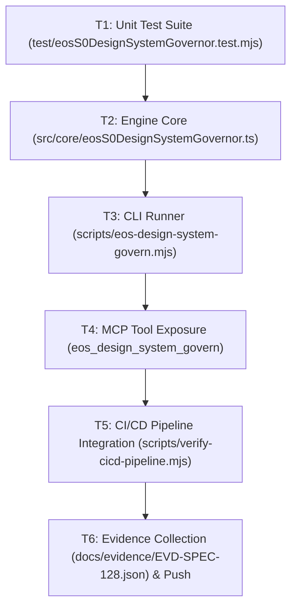

# SPEC-128: Tier S-0 Design Engineering Matrix & Machine-Readable Visual Governor

## 1. Metadata & Status
- **Specification ID**: `SPEC-128`
- **Title**: `Tier S-0 Design Engineering Matrix & Machine-Readable Visual Governor`
- **Version**: `1.0.0`
- **Status**: `APPROVED`
- **Author**: `Valentín Flórez Arbeláez (Principal Architect) & Antigravity (EOS Agent)`
- **Date**: `2026-11-02`
- **Epistemic State**: `SPECIFICATION_APPROVED`
- **Constitutional Alignment**: `EOS Constitution Laws I, II, III, IV, V, VI, VII`

---

## 2. Executive Context & Problem Statement
To guarantee that every user interface across the EOS System and its fleet achieves the visual caliber of Palantir, Anduril, Linear, Vercel, and Stripe, design must be governed as a mathematical and machine-readable contract rather than subjective improvisation. This specification establishes:
1. The formalization of `DESIGN.md` as the supreme visual engineering contract.
2. A Layer-0 static design token and anti-pattern governor (`src/core/eosS0DesignSystemGovernor.ts`) that audits HTML, CSS, and TSX files for token adherence, contrast ratios, and banned visual patterns.
3. Integration with the EOS MCP Control Plane via `eos_design_system_govern`.
4. Command-line integration via `npm run design:govern`.

---

## 3. Functional Requirements (IEEE 830 / EARS)

### FR-401: 3-Tier Token Invariant Verification
EL SISTEMA debe verificar que las hojas de estilo y componentes implementen y respeten los tokens de 3 niveles definidos en `DESIGN.md` (primitivos, semánticos y de componente).

### FR-402: Banned Anti-Pattern Detection
CUANDO el auditor de diseño analiza un archivo HTML, CSS o componente, EL SISTEMA debe identificar y rechazar cualquier sombra difusa genérica (`shadow-lg`, `box-shadow: 0 10px 15px...`), transiciones lineales no físicas (`transition: ... linear`), o valores de espaciado fuera de la rampa geométrica de 4px.

### FR-403: Zero-Arbitrary-Hex-Color Invariant
EL SISTEMA debe marcar como infracción cualquier color hexadecimal arbitrario incrustado directamente en estilos en línea o clases ad-hoc cuando exista un token semántico correspondiente en `DESIGN.md`.

### FR-404: Tabular Numeric Enforcement
CUANDO se renderizan métricas, latencias, saldos monetarios o códigos hash, EL SISTEMA debe comprobar la presencia de la propiedad `font-variant-numeric: tabular-nums` o tipografía monoespaciada técnica para prevenir desalineaciones visuales.

### FR-405: Contrast Ratio Verification (WCAG 2.1 AA)
EL SISTEMA debe verificar que las combinaciones de color de texto sobre fondo cumplan un ratio de contraste mínimo de $4.5:1$ para texto normal y $3.0:1$ para texto grande.

### FR-406: Corner Crosshair Grid Alignment
CUANDO se definen secciones tácticas o Bento Grids en el modo Palantir/Anduril, EL SISTEMA debe verificar la presencia de elementos indicadores de esquina (`+`) en las intersecciones del contenedor.

### FR-407: MCP Tool Dispatch for Design Governance
CUANDO un agente o cliente MCP invoca `eos_design_system_govern`, EL SISTEMA debe ejecutar la auditoría de conformidad de diseño sobre el proyecto especificado y retornar un informe estructurado con el índice de perfección visual (0-100%).

### FR-408: Zero External Runtime Dependencies
EL SISTEMA debe implementar todo el analizador estático de diseño utilizando exclusivamente las bibliotecas nativas de Node.js (`node:fs`, `node:path`, `node:crypto`).

---

## 4. Acceptance Criteria (BDD / Gherkin)

```gherkin
ESCENARIO: BDD-383 Detección de Sombras Difusas Prohibidas (Anti-Pattern Linter)
  DADO un fragmento de CSS o markup con "box-shadow: 0 10px 15px -3px rgba(0,0,0,0.1)"
  CUANDO "EosS0DesignSystemGovernor.auditMarkup()" analiza el contenido
  ENTONCES reporta una violación de severidad BLOCKING por sombra difusa prohibida.

ESCENARIO: BDD-384 Verificación de Rampa Geométrica de 4px
  DADO un estilo con espaciado "padding: 13px"
  CUANDO se audita contra la escala geométrica de DESIGN.md
  ENTONCES detecta un espaciado no conforme a la cuadrícula de 4px.

ESCENARIO: BDD-385 Certificación de Tipografía Tabular para Telemetría
  DADO un bloque de métricas o telemetría en vivo
  CUANDO se evalúa la jerarquía tipográfica
  ENTONCES verifica que incluya "tabular-nums" o "font-mono".

ESCENARIO: BDD-386 Auditoría del Contrato DESIGN.md
  DADO el archivo "DESIGN.md" en la raíz del repositorio
  CUANDO se ejecuta la auditoría de contratos
  ENTONCES valida la existencia de los tokens de nivel 1, 2 y 3.

ESCENARIO: BDD-387 Despacho de Herramienta MCP eos_design_system_govern
  DADO el servidor MCP "EosMcpServer"
  CUANDO se invoca "eos_design_system_govern"
  ENTONCES retorna un informe JSON con el puntaje de conformidad estética y lista de hallazgos.
```

---

## 5. Architectural Decision Records (ADRs)

### ADR-128-1: Pure AST Regex & Token Scanning (Zero Third-Party Linters)
- **Context**: Relying on external heavy CSS parsers introduces dependency bloat (violating Law V).
- **Decision**: Implement a fast, deterministic token scanner using Node.js built-ins to identify prohibited patterns and verify 3-tier token coverage in < 25ms.
- **Consequences**: Instantaneous execution in CI/CD pipeline without npm overhead.

### ADR-128-2: 3-Tier Token Standard Alignment
- **Context**: Design tokens must be reusable across both Vanilla CSS (EOS landing) and Next.js / Tailwind (fleet apps like Biblioteca Gnóstica and Crud-Slack).
- **Decision**: Define CSS Custom Properties compatible with Tailwind `@theme` and standard CSS variables.
- **Consequences**: Universal cross-project portability.

---

## 6. Atomic Task DAG


